# OpsPilot AI — Agent Run Console with Human Approval

OpsPilot AI is an operations copilot built with **Next.js 16 (App Router)** and **FastAPI (Python 3.12)** backed by **PostgreSQL 17**. It assists operations teams with automated customer order analysis and policy-governed refund drafting, while placing write actions behind a human approval boundary.

---

## Architecture Diagram & System Overview

```mermaid
flowchart TD
  subgraph Frontend["Next.js 16 Console (App Router and TypeScript)"]
    Composer["New run page / (Server) + composer (Client)"]
    History["Runs page /runs (Server) + auto-refresh (Client)"]
    RunPage["Run page /runs/:id (Server: loads the snapshot)"]
    Console["RunConsole (Client island): trace, tool views, inspector"]
    ApprovalUI["Approval card"]
    Reducer["Pure reducer + view models (timeline, now line, budget)"]
    StreamReader["useRunStream + stream loop (cursor, gaps, back-off)"]
    ApiProxy["Same-origin /api proxy"]
  end

  subgraph Backend["FastAPI Backend (Async and Typed Pydantic v2)"]
    HTTPRoutes["HTTP Endpoints (/runs, /approve, /stop)"]
    SSEEndpoint["GET /runs/:id/stream (SSE Replay)"]
    Broker["In-Memory Event Broker (Wake-up Hints)"]
  end

  subgraph Database["PostgreSQL 17 (SQLAlchemy 2.0 Async and Alembic)"]
    RunsTbl[("runs - state machine and budgets")]
    MsgsTbl[("messages - transcripts")]
    CallsTbl[("tool_calls - inputs and outputs")]
    ApprTbl[("approvals - pending and decisions")]
    EventsTbl[("run_events - monotonically ordered")]
    OrdersTbl[("orders - 30 seeded orders")]
    RefundsTbl[("refunds - simulated ledger")]
  end

  subgraph Runner["Single-Process Lifespan Worker"]
    QueueClaim["Atomic Queue Claim (Advisory Lock)"]
    AgentLoop["Bounded Native Tool Loop"]
    UsageAccounting["Token and Cost Tracking"]
  end

  subgraph Providers["LLM Provider Boundary"]
    Adapter["Anthropic / Groq / ScenarioProvider"]
  end

  subgraph Tools["Typed Tool Registry"]
    DateMath["date_math (calendar operations)"]
    QueryOrders["query_orders (typed filters)"]
    SearchPolicies["search_policies (policy retrieval)"]
    IssueRefund["issue_refund (approval-gated write)"]
  end

  Composer -->|POST /api/runs| ApiProxy
  ApiProxy -->|POST /runs - 202 Accepted| HTTPRoutes
  HTTPRoutes -->|Persist run and message| RunsTbl
  HTTPRoutes -->|Persist user message| MsgsTbl
  HTTPRoutes -->|Append run.queued| EventsTbl

  QueueClaim -->|Atomic claim FOR UPDATE| RunsTbl
  QueueClaim -->|Reconstruct messages and run| AgentLoop

  AgentLoop -->|Stream conversation turns| Adapter
  Adapter -->|Text deltas and tool calls| AgentLoop
  AgentLoop -->|Batch ~100ms deltas| EventsTbl
  AgentLoop -->|Dispatch read tools| DateMath
  AgentLoop -->|Dispatch read tools| QueryOrders
  AgentLoop -->|Dispatch read tools| SearchPolicies

  AgentLoop -->|Propose refund| IssueRefund
  IssueRefund -->|Persist pending approval| ApprTbl
  IssueRefund -->|Pause run and release worker| RunsTbl

  ApprovalUI -->|POST /api/runs/:id/approve| ApiProxy
  HTTPRoutes -->|Save decision and requeue run| ApprTbl
  HTTPRoutes -->|Requeue run| RunsTbl
  QueueClaim -->|Resume approved batch| AgentLoop
  AgentLoop -->|Verify order and commit refund| RefundsTbl

  StreamReader -->|GET /api/runs/:id/stream?after=N| ApiProxy
  ApiProxy -->|GET /runs/:id/stream?after=N| SSEEndpoint
  SSEEndpoint -->|Read bounded committed events| EventsTbl
  Broker -.->|Post-commit wake-up hint| SSEEndpoint
  SSEEndpoint -->|id, event, data frames| ApiProxy
  ApiProxy -->|Unbuffered SSE frames| StreamReader
  RunPage -->|GET /runs/:id snapshot| HTTPRoutes
  RunPage -->|Initial snapshot| Console
  History -->|GET /runs?page=N| HTTPRoutes
  StreamReader -->|Contiguous events only| Reducer
  Reducer --> Console
  Console --> ApprovalUI
```



---

## Setup Instructions

### Prerequisites
- **Containerized Run (Recommended):** [Docker Desktop](https://www.docker.com/products/docker-desktop/) or Docker Engine with Docker Compose v2.
- **Native Local Development (Optional):** Python 3.12+, Node.js 20+, [pnpm](https://pnpm.io/) 10+, [uv](https://docs.astral.sh/uv/) package manager, and a local PostgreSQL 17 instance.

---

### Option A: Quick Start with Docker Compose (Recommended)

1. **Clone and configure environment:**
   ```sh
   cp .env.example .env
   ```
   *(By default, `LLM_PROVIDER=fake` runs offline deterministic multi-turn scenarios without needing any external API keys).*

2. **Launch all containers in detached mode:**
   ```sh
   docker compose up --build -d
   ```

3. **Verify running containers and health:**
   ```sh
   docker compose ps
   ```

4. **Follow startup logs:**
   ```sh
   docker compose logs -f backend
   ```

5. **Stop containers (preserving database volume):**
   ```sh
   docker compose down
   ```

---

### Option B: Native Local Development Setup

If running without Docker:

1. **Start PostgreSQL 17:**
   Ensure a local PostgreSQL instance is running on port 5432 with a database named `opspilot`.

2. **Set up the Backend (FastAPI):**
   ```sh
   cd backend
   uv sync
   uv run alembic upgrade head
   uv run python -m app.seed
   uv run uvicorn app.main:app --reload --port 8000
   ```

3. **Set up the Frontend (Next.js):**
   ```sh
   cd frontend
   pnpm install
   pnpm dev
   ```

---

### Browser API Connection & Proxy Routing

The browser sends commands, readiness checks, and SSE subscriptions to `/api` on the **same origin as the console**. Next.js forwards them to `API_INTERNAL_URL` (`http://backend:8000` in Compose; `http://127.0.0.1:8000` for native development). No browser-side port mapping or CORS permission is needed for the default console path, including the isolated test ports. SSE bodies are forwarded without buffering, with the replay cursor intact.

`NEXT_PUBLIC_API_BASE_URL` is an optional **build-time** override for deployments intentionally using a separate browser API. Such deployments must configure CORS and browser network permissions themselves; do not set this override for the normal Compose setup.

After pulling a frontend or backend fix, rebuild the running services from the repository root:
```sh
docker compose up -d --build --wait backend frontend
```

### Access Points
- **Next.js Console:** [http://localhost:3000](http://localhost:3000) (or [http://127.0.0.1:3000](http://127.0.0.1:3000))
- **FastAPI Interactive Docs (Swagger):** [http://localhost:8000/docs](http://localhost:8000/docs)
- **Backend Readiness Probe:** [http://localhost:8000/health/ready](http://localhost:8000/health/ready)
- **Backend Liveness Probe:** [http://localhost:8000/health/live](http://localhost:8000/health/live)

---

## Configuration & Model Providers

Copy `.env.example` to `.env` to configure your chosen model provider. The application starts without credentials using the built-in offline `ScenarioProvider` (`LLM_PROVIDER=fake`).

```sh
cp .env.example .env
```

| `LLM_PROVIDER` | Required Settings | Capabilities |
| --- | --- | --- |
| `anthropic` *(default)* | `ANTHROPIC_API_KEY`, `ANTHROPIC_MODEL=claude-haiku-4-5-20251001` | Claude native Messages API with streaming tool calling. |
| `groq` | `GROQ_API_KEY`, `GROQ_MODEL=openai/gpt-oss-20b` | High-speed native function calling on hosted models. |
| `fake` | *No key needed* | Deterministic multi-turn scenario simulation for offline demos and CI. |

Restart the backend container to apply environment changes:
```sh
docker compose up -d --build --wait
```

---

## Business Scenario & Database Seed Data

OpsPilot simulates an operations assistant for an e-commerce platform:
1. **Orders Database:** 30 synthetic orders seeded across qualifying and non-qualifying cases (orders below, equal to, and above \$500; on-time shipments; late shipments; cancelled and already refunded orders).
2. **Explicit Reference Date:** Seeded relative to fixed UTC date `2026-02-15` (qualifying month is January 1 to February 1 exclusive). Database restarts never reset or duplicate existing records.
3. **8 Shipping Policies:** Bundled in `backend/policies/` covering shipping commitments, late-shipment refund eligibility, refund calculation rules, exclusions, duplicate requests, email drafts, and escalation.
4. **Fictional Refund Calculation:** Qualifying late shipments receive 10% of order value capped at \$100. Fractional cents are rounded using `ROUND_HALF_UP` in integer cents (`amount_minor`).
5. **Simulated Ledger:** Refunds are written transactionally to a simulated ledger table (`refunds`). No real money moves.

---

## Typed Tools Catalog

The agent loop dispatches four strictly typed tools:

| Tool Name | Type | Behavior |
| --- | --- | --- |
| `date_math` | Read | Computes calendar boundaries in the run's business timezone (e.g. `previous_month`). |
| `query_orders` | Read | Queries orders using typed parameters (`order_id`, `start`, `end`, `min_amount_minor`, `late_only`, `status`). SQL injection is structurally impossible. |
| `search_policies` | Read | Deterministic keyword search over 8 markdown policies, returning ranked matches with policy IDs and excerpts. |
| `issue_refund` | Write *(Approval-Gated)* | Calculates eligible refund from order and policy evidence. Proposes an immutable approval record and **pauses the run**. Upon human approval, writes exactly once to the simulated refund ledger. |

---

## Core Scenarios to Run

### Scenario 1: Read-Only Analysis & Email Drafts (No Write Action)
Choose the **Draft late-shipment emails** scenario on the New run page (`/`), or paste:
> *"Find orders over \$500 that shipped late last month and draft a short refund email for each. Cite the applicable policy. Keep each email to two sentences."*

- **What Happens:** The agent calls `date_math`, `query_orders`, and `search_policies`. It composes email drafts directly in its response.
- **Verification:** No approval card appears. Each draft is an email card with its own copy button. The simulated refund ledger has zero new entries.

### Scenario 2: Explicit Refund with Human Approval
Paste this goal:
> *"Check the late-shipment policy and issue the eligible simulated refund for ORD-1006. Show the proposed amount and evidence for my approval."*

- **What Happens:** The agent queries order `ORD-1006` (\$845.05) and policy v1 (10% up to \$100). It calculates \$84.51 USD (8,451 cents), pauses execution, and presents an **Approval Card**.
- **Reload Survival:** Refresh the browser page (`F5`). The same approval card reappears with exact details, and the tab title says "Approval needed".
- **Decision:** Click **Approve refund**. The worker claims the resumed run, records the simulated ledger entry, and outputs the final confirmation.

### Scenario 3: Rejection with Required Reason
Paste this goal:
> *"Please issue the eligible late-shipment refund for ORD-1001 and wait for my decision."*

- **What Happens:** The agent pauses for `ORD-1001` (\$62.50). Click **Reject…** and enter a reason (*"Customer requested store credit"*). A blank reason is refused.
- **Verification:** The rejection reason is passed back to the agent as a tool observation. The agent acknowledges it. Zero rows are added to the refund ledger.

### Scenario 4: Stopping a Run
Click **Stop** (then **Stop run** to confirm) on any queued, running, or waiting run.
- **What Happens:** The run transitions through `cancelling` to `cancelled`. Partial output is preserved. Pending approvals are marked cancelled. Closing the browser tab does **not** cancel a run.

---

## Design Decisions

| Decision | Choice | Rationale |
| :--- | :--- | :--- |
| **Agent Orchestration** | Native Async Tool Loop (No heavy framework) | Built directly with Python 3.12 async generators and Pydantic v2 schemas. Avoids opaque framework abstractions (e.g. LangChain, CrewAI), providing full observability over continuation contexts, step limits, token budgets, and pause/resume transactions. |
| **State Persistence** | PostgreSQL 17 as Single Source of Truth | Every state transition (`queued` $\to$ `running` $\to$ `awaiting_approval` $\to$ `completed`/`failed`/`cancelled`), message transcript, tool call, and monotonic event is durably committed before dispatching. Runs survive container crashes and browser reloads without in-memory dependency. |
| **Browser Transport** | Server-Sent Events (SSE) + HTTP POST | One-way SSE stream for real-time text deltas and tool lifecycle telemetry. Reconnects via `Last-Event-ID` or `?after=N` replay committed events from the database. Explicit user actions (Approve, Reject, Stop) use standard HTTP POST requests. |
| **Network Architecture** | Same-Origin Next.js Reverse Proxy (`/api/*`) | Direct browser-to-backend requests across ports (`:8000` vs `:3000`) encounter CORS preflight and private-network permission blocks. Next.js App Router catch-all route forwards requests server-to-server to `API_INTERNAL_URL` (`http://backend:8000`) with unbuffered streaming. |
| **Safety Guardrail** | Human-in-the-Loop Financial Boundary | Write actions (`issue_refund`) cannot execute autonomously. When proposed, the agent loop pauses, commits a pending approval record, and yields the worker. Execution only resumes after a human operator explicitly approves or rejects the action with a mandatory reason. |
| **Server/Client Split** | Server pages, one client island per live view | Pages and the layout are Server Components that load data next to the backend and return expected failures as values. The run console is a single client island because everything in it follows the stream; elsewhere, client code is limited to small interactive leaves (composer, theme toggle, auto-refresh). |
| **Live Trace State** | Pure reducer + view models + React-free stream loop | The SSE loop resumes from the snapshot cursor, accepts only contiguous sequences, reloads the snapshot on a gap or disconnect, and backs off between retries. The reducer groups tool calls the same way the server does (calls requested before their turn's `message.completed` wait for it), so the live trace and the replay match. Both are unit-tested without React. |
| **Rendering Untrusted Output** | react-markdown without raw HTML | Model text is rendered with raw HTML dropped, images disabled and links limited to http, https and mailto. There is no `dangerouslySetInnerHTML` in the app; the theme uses a cookie read on the server instead of an inline script. Email drafts become cards with copy buttons. |
| **Design System** | Tailwind v4 tokens + small owned components | One token table (light and dark through `light-dark()`), semantic status colors always paired with an icon and a label, Radix primitives for tabs, dialog and tooltip, and no component kit. axe checks WCAG 2.2 AA in both themes. |

---

## Technical Trade-offs

| Area | Approach Chosen | Trade-off & Compromise |
| :--- | :--- | :--- |
| **Worker Architecture** | Single-Process Lifespan Worker with PostgreSQL Locks | Eliminates external task broker dependencies (Redis, RabbitMQ, Celery), making local startup instant and reliable. However, multiple queued runs are processed sequentially rather than distributed across parallel worker nodes. |
| **Streaming Protocol** | Server-Sent Events (SSE) instead of WebSockets | SSE is simpler, HTTP/2-friendly, cacheable, and features native browser reconnection. However, it is unidirectional; commands require separate HTTP POST requests instead of duplex messaging over a single socket. |
| **Currency Arithmetic** | Integer Cents (`amount_minor`) instead of Float | All calculations ($R_{\text{cents}} = \min(\lfloor A_{\text{cents}} \times 0.10 + 0.5 \rfloor, 10000)$) use integer cents and `ROUND_HALF_UP`. Eliminates IEEE-754 floating-point precision bugs; requires explicit division by 100 when rendering formatted currency to users. |
| **Policy Search Engine** | In-Memory BM25 Keyword Search instead of Vector Database | Zero embedding API latency, zero external vector database overhead, and deterministic citations across the 8 bundled markdown policies. However, it does not support semantic paraphrase matching for thousands of unstructured documents. |
| **Time Management** | Pinned Reference Date (`2026-02-15` UTC) for Demo Seed | Guarantees 100% reproducible test assertions and offline scenario reliability regardless of when tests run. In production mode, reference time defaults to real-time `datetime.now(timezone.utc)`. |

---

## Known Gaps

1. **Horizontal Worker Auto-Scaling:** The worker currently uses an in-process queue loop with PostgreSQL advisory locks. Scaling across multiple container replicas requires distributed queue leasing with worker heartbeat health checks.
2. **Multi-User Authentication & RBAC:** Currently operates as a single-tenant operations console. Multi-user enterprise deployment requires JWT/OIDC authentication with role separation (e.g., Tier-1 Support Operator vs. Finance Manager).
3. **Outbound Channel Connectors:** While the system drafts emails and commits simulated ledger entries, outbound email delivery (via SendGrid/AWS SES) and real banking/Stripe transfers are not wired to live external APIs.
4. **Vector Search for Large Policy Corpora:** Policy retrieval uses BM25 keyword matching suitable for small policy collections; larger corpora require hybrid pgvector indexing.

---

## Future Improvements

1. **Webhook & Collaboration Integrations:** Real-time Slack/Microsoft Teams notifications with interactive approval buttons when runs enter `awaiting_approval`.
2. **Multi-Agent Separation of Concerns:** Decoupling research (investigating orders/policies) from calculation auditing (verifying mathematical proofs) into two specialized collaborating subagents.
3. **Live Payment Gateway Sandboxes:** Connect the simulated ledger to real developer sandboxes (Stripe Test Mode, Adyen Test Platform) for end-to-end payment settlement.
4. **Automated Continuous Benchmarking:** CI suite running golden operational datasets to detect precision/recall regressions across LLM prompt and model version bumps.

---

## Local Verification & Test Execution

### 1. Backend Unit & Integration Tests
Run from `backend/`:
```sh
cd backend
uv sync --locked
uv run ruff check .
uv run mypy app
uv run pytest
```
When `TEST_DATABASE_URL` is configured to an accessible PostgreSQL instance, full integration suites run automatically:
```sh
uv run pytest -q tests/integration/test_scenario_reliability.py tests/integration/test_streaming.py
uv run pytest -q tests/integration/test_agent_loop.py tests/integration/test_approvals.py tests/integration/test_approvals_api.py tests/integration/test_cancellation.py tests/integration/test_refund_execution.py tests/integration/test_worker.py
```

### 2. Frontend Checks & Unit Tests
Run from `frontend/`:
```sh
cd frontend
pnpm install --frozen-lockfile
pnpm lint
pnpm typecheck
pnpm test             # unit tests for src/lib (node --test)
pnpm test:coverage    # the same, with coverage of src/lib
pnpm build
```

### 3. Isolated Compose & Playwright E2E Tests
To test the complete end-to-end stack in an isolated Docker environment without external keys:
```sh
export P8_PROJECT="opspilot-p8-test"
docker compose --env-file .env.example -p "$P8_PROJECT" -f compose.yaml -f compose.phase8.yaml up --build --wait -d
curl -fsS http://127.0.0.1:18000/health/ready
curl -fsS -o /dev/null http://127.0.0.1:13000/
(cd frontend && pnpm exec playwright install chromium && E2E_EXTERNAL_STACK=1 pnpm exec playwright test)
docker compose -p "$P8_PROJECT" -f compose.yaml -f compose.phase8.yaml down -v --remove-orphans
```
The suite covers the draft, approval, rejection and stop journeys, route states, and axe accessibility checks in both themes. It expects a fresh stack: approving `ORD-1006` writes to the simulated ledger once.

---

## Reviewer Guides
- **Architecture & Trace Details:** [`docs/architecture.md`](docs/architecture.md)
- **Demo Script & Interview Rehearsal:** [`docs/demo-script.md`](docs/demo-script.md)
- **Frontend Data Flow, Boundaries & Extension Points:** [`docs/frontend.md`](docs/frontend.md)
