# OpsPilot AI — Architecture and End-to-End Trace

This document describes the architectural flow, state machine, data models, and transaction boundaries of OpsPilot AI, including sign-in and run ownership and the hybrid policy search.

---

## 1. System Architecture

```mermaid
flowchart TD
  Browser(["Browser (holds only the HttpOnly session cookie)"])

  subgraph Frontend["Next.js 16 Console (Client & Server Components)"]
    Gate["proxy.ts (optimistic cookie check)"]
    SignIn["/login with signIn and signOut Server Actions"]
    Composer["Goal Composer"]
    Console["Run Console & State Reducer"]
    Timeline["Execution Timeline"]
    ApprovalUI["Human Approval Card"]
    StreamClient["SSE ReadableStream Client"]
    ApiProxy["Same-origin /api proxy (cookie to Bearer token)"]
  end

  subgraph API["FastAPI Backend (Async Endpoints)"]
    AuthRoutes["/auth Routes (login, logout, me)"]
    Routes["/runs Routes (POST, GET, /stream, /approve, /stop), owner only"]
    EventsService["Events & Sequence Broker"]
  end

  subgraph Database["PostgreSQL 17 + pgvector"]
    UsersTbl[("users")]
    SessionsTbl[("user_sessions")]
    RunsTbl[("runs")]
    MsgsTbl[("messages")]
    CallsTbl[("tool_calls")]
    ApprTbl[("approvals")]
    EventsTbl[("run_events")]
    OrdersTbl[("orders")]
    RefundsTbl[("refunds ledger")]
    ChunksTbl[("policy_chunks (tsvector + vector)")]
  end

  subgraph Worker["Single-Process Lifespan Runner"]
    QueueClaim["Advisory Lock & Queue Claim"]
    AgentLoop["Bounded Tool Loop"]
    UsageTracker["Token & Cost Accounting"]
  end

  subgraph Provider["LLM Provider Interface"]
    ProviderAdapter["Anthropic / Groq / Scenario"]
  end

  subgraph Tools["Typed Tool Catalog"]
    DateMath["date_math"]
    QueryOrders["query_orders"]
    SearchPolicies["search_policies (hybrid)"]
    IssueRefund["issue_refund (Approval Gated)"]
  end

  Embedder["Local embedding model (bge-small-en-v1.5)"]
  Seed["Seed on every start"]

  Browser -->|Page request| Gate
  Gate -->|No session cookie| SignIn
  SignIn -->|POST /auth/login, POST /auth/logout| AuthRoutes
  SignIn -.->|Set-Cookie opspilot_session| Browser
  AuthRoutes -->|Verify argon2id hash| UsersTbl
  AuthRoutes -->|Store or revoke token hash| SessionsTbl
  Routes -->|Bearer token to user via its SHA-256| SessionsTbl

  Composer -->|POST /api/runs| ApiProxy
  ApiProxy -->|POST /runs + Bearer| Routes
  Routes -->|Persist run with its owner| RunsTbl
  Routes -->|Persist run & user message| MsgsTbl
  Routes -->|Append run.queued| EventsTbl

  QueueClaim -->|Atomic claim & mark running| RunsTbl
  QueueClaim -->|Reconstruct history| MsgsTbl
  QueueClaim -->|Start turn| AgentLoop

  AgentLoop -->|Stream turn messages| ProviderAdapter
  ProviderAdapter -->|Text deltas & tool calls| AgentLoop
  AgentLoop -->|Append message.delta & tool.requested| EventsTbl
  AgentLoop -->|Dispatch read tools| DateMath
  AgentLoop -->|Dispatch read tools| QueryOrders
  AgentLoop -->|Dispatch read tools| SearchPolicies
  SearchPolicies -->|Embed the query| Embedder
  SearchPolicies -->|ID, full-text & cosine similarity| ChunksTbl
  Seed -->|Embed new or changed paragraphs| ChunksTbl
  Seed -->|Create or update demo users| UsersTbl

  AgentLoop -->|Propose refund| IssueRefund
  IssueRefund -->|Persist pending approval| ApprTbl
  IssueRefund -->|Pause run & release worker| RunsTbl

  ApprovalUI -->|POST /api/runs/:id/approve| ApiProxy
  Routes -->|Verify proposal & requeue| ApprTbl
  Routes -->|Requeue run| RunsTbl
  QueueClaim -->|Resume approved tool batch| AgentLoop
  AgentLoop -->|Lock order & commit refund| RefundsTbl

  StreamClient -->|GET /api/runs/:id/stream?after=N| ApiProxy
  ApiProxy -->|GET /runs/:id/stream?after=N + Bearer| Routes
  Routes -->|Read bounded committed events| EventsTbl
  Routes -.->|Re-check the session at every wake-up| SessionsTbl
  EventsService -.->|Wake-up hint after commit| Routes
  Routes -->|SSE frames id, event, data| ApiProxy
  ApiProxy -->|Unbuffered SSE frames| StreamClient
  StreamClient -->|Deduplicate & reduce| Console
  Console --> Timeline & ApprovalUI
```

---

## 2. Request & Execution Lifecycle Trace

### Step 0: Sign-in
1. A page request without the `opspilot_session` cookie is redirected by `proxy.ts` to `/login?next=<page>`. This is only an optimistic check (is a token-shaped cookie present?); FastAPI makes the real one on every call.
2. The sign-in form posts to the `signIn` Server Action, which calls `POST /auth/login` from the Next.js server.
3. FastAPI checks the login throttle, verifies the password (section 5) and stores a new `user_sessions` row that holds only the SHA-256 of a fresh random token.
4. The Server Action puts the token into the HttpOnly cookie (`Max-Age` until the session's `expires_at`) and redirects to `next`, after `safeNextPath` has checked that it is a path on this site. From then on, server loaders and the `/api` proxy send the token as `Authorization: Bearer <token>`; browser JavaScript never sees it.

### Step 1: Goal Submission
1. The user enters an operations goal in the Next.js Goal Composer (`/`).
2. Client sends `POST /api/runs` with `{"goal": "..."}` to the console's own origin. The [Next.js API proxy](../frontend/src/app/api/[...path]/route.ts) forwards the request to `POST /runs` at the server-only `API_INTERNAL_URL`, turning the session cookie into a bearer token. This removes browser CORS, private-network permission, and guessed-port dependencies.
3. FastAPI resolves the bearer token to the signed-in user (`401` if it is missing, unknown, expired or revoked), validates the goal length ($1 \le \text{length} \le 2000$) and begins a short transaction:
   - Inserts `runs` row with `user_id` set to the caller, `status = "queued"`, budget limits, and `next_event_sequence = 2`.
   - Inserts `messages` row with `index = 0`, `role = "user"`, `text = goal`.
   - Inserts `run_events` row with `sequence = 1`, `type = "run.queued"`.
   - Commits transaction and returns `202 Accepted` with `RunSummary`.
4. Client navigates to `/runs/{id}`.

### Step 2: Queue Claim & Worker Execution
1. The background worker claims one queued run using PostgreSQL `FOR UPDATE` row lock.
2. If `cancellation_requested` is true, it marks the run cancelled immediately.
3. Otherwise, it updates `status = "running"`, appends `run.started` (sequence 2), and commits.
4. The worker loads all persisted messages and claims an `LLMProvider` instance via `resolve_run_provider`.

### Step 3: Model Turn & Live Streaming
1. `Execution.stream_turn` invokes the provider stream.
2. As the model produces tokens:
   - Early text is batched at $\approx 100\text{ms}$ or $4096$ characters to avoid excessive database writes.
   - Text chunks are appended to the assistant message in `messages` and committed with a `message.delta` event.
   - PostgreSQL `after_commit` hook notifies active SSE stream subscribers.
   - The browser's `GET /runs/{id}/stream` reader receives the SSE frame, deduplicates by sequence, and updates the live UI before the model finishes.
3. Tool calls requested by the model are persisted as `tool_calls` rows (`status = "requested"`) and emitted as `tool.requested` events.

### Step 4: Tool Execution & Human Approval Boundary
1. **Read tools** (`date_math`, `query_orders`, `search_policies`):
   - Dispatched outside the trace lock to avoid blocking other operations.
   - `search_policies` embeds the query before its first SQL statement, then ranks the `policy_chunks` index (section 6).
   - When finished, results reacquire the run lock, save a tool observation message (`role = "tool"`), and commit with `tool.completed`.
2. **Approval-gated tool** (`issue_refund`):
   - The engine checks for an existing approved record.
   - If none exists, it executes `propose`:
     - Calculates eligible refund based on order amount and shipping policies ($10\%$, capped at $\$100$).
     - Inserts an `approvals` row with `status = "pending"`, proposed arguments, and digest.
     - Updates `runs.status = "awaiting_approval"`.
     - Appends `approval.required` and commits.
     - Raises `RunPaused`, releasing the worker process so it consumes no resources while waiting for human review.

### Step 5: Decision & Resumption
1. The operator reviews the pending card in the Next.js console (which survived browser reloads).
2. The operator clicks **Approve** (or **Reject** with a reason), sending `POST /runs/{id}/approve`:
   - Validates that the approval belongs to this run and is currently pending.
   - Re-checks cancellation and terminal state under run lock.
   - Updates approval status (`"approved"` or `"rejected"`).
   - Requeues the run (`status = "queued"`), appends `approval.decided`, and commits.
3. The worker claims the queued run again.
4. When `issue_refund` executes this time, `resolve` finds the approved proposal:
   - Re-validates order refundable balance and eligibility.
   - Inserts unique `refunds` ledger entry (`order_id`, `amount_minor`, `policy_version`, `tool_call_id`).
   - Updates tool call status to `"completed"`.
   - Appends `tool.completed` and commits.
5. The model receives the tool success observation and composes its final closing text.
6. The run transitions to `completed`, appends `run.completed`, and the SSE stream closes cleanly.

---

## 3. Replay Protocol & Snapshot Consistency

- Every `/runs/{id}` route (snapshot, stream, approve, stop) first checks that the caller owns the run. Another user's run, an ownerless run and a missing run all answer `404 Run not found`, so a run ID reveals nothing.
- `GET /runs/{id}` reads the full trace under a shared read lock (`FOR UPDATE READ`), ensuring `snapshot_cursor` equals the exact sequence of the latest event included in the snapshot.
- `GET /runs/{id}/stream?after=N` and `Last-Event-ID: N` stream only events with $\text{sequence} > N$.
- If `Last-Event-ID` and `?after` are both provided, `Last-Event-ID` takes precedence.
- If a client connects to a completed run with an already consumed cursor ($N \ge \text{latest\_sequence}$), the endpoint returns `204 No Content`.
- The stream re-checks the caller's session each time it opens a database session (before every batch and after every 15-second keepalive wait) and ends once the session is revoked or expired; reconnecting with that token gets `401`.
- The frontend reducer ignores duplicate sequences and detects sequence gaps, reconciling with a fresh snapshot if a gap is ever observed.

---

## 4. Cancellation & Concurrency Invariants

1. **Cancellation (`POST /runs/{id}/stop`)**:
   - Acquires the run lock and sets `cancellation_requested = true`.
   - Parked work is cancelled immediately; in-flight model calls are interrupted cleanly.
   - Disconnecting a browser stream does **not** stop or cancel the run.
2. **Write Race Safety**:
   - `stop_run` and refund execution lock the same run row.
   - If Stop wins the lock, no refund commits.
   - If refund commit wins the lock, the refund remains valid and visible in the trace, and the run transitions to cancelled afterward.
3. **Approval Idempotency**:
   - Repeated identical approval requests return the stored result without duplicate writes or extra events.
   - Conflicting or stale decisions return `409 Conflict`.

---

## 5. Accounts, Sessions & Run Ownership

The console is a backend-for-frontend: FastAPI issues the session token, and only the Next.js server holds it. The browser side (cookie, `proxy.ts`, Server Actions) is described in the [frontend guide](frontend.md#sign-in-and-the-session-cookie); the backend lives in `backend/app/auth/`.

1. **Sign-in (`POST /auth/login`)**:
   - The email is trimmed and lower-cased; the password must be 1–128 characters, which bounds the hashing work. An app-wide handler keeps only each validation error's type, location and message, so a `422` never echoes a submitted value such as a password.
   - The handler then checks the throttle: once 5 attempts for one email (`LOGIN_MAX_FAILURES`), or 50 across all emails, have failed within the window (`LOGIN_WINDOW_SECONDS`, 900 s), sign-in answers `429` with `Retry-After` and "Too many sign-in attempts. Try again in N minutes." The attempt is recorded as a failure *before* the password check, with no `await` in between, so a burst of parallel guesses cannot all slip past the limit; a correct password clears that email's failures.
   - The user is looked up in its own short transaction, then argon2id (argon2-cffi defaults: 3 passes, 64 MiB, 4 lanes, about 50 ms of CPU) runs in a worker thread, so no database connection waits on the hash and the event loop keeps serving streams. An unknown email is checked against a dummy hash, so it takes as long as a wrong password, and both get the same `401 Invalid email or password`.
   - On success the server stores a `user_sessions` row with the SHA-256 of a fresh `secrets.token_urlsafe(32)` token (256 bits) and an absolute expiry (`SESSION_TTL_HOURS`, 12 h), and returns the token, `expires_at` and the public user (id, email, display name), never a hash.
2. **Every `/runs` request**: `get_current_user` hashes the bearer token and looks for a session that is neither revoked nor expired; anything else gets the same `401 Not authenticated` with `WWW-Authenticate: Bearer`. It is a dependency of the whole `/runs` router, so a run route added later cannot forget it. Health endpoints stay public, and `GET /auth/me` returns the signed-in user.
3. **Ownership**: `POST /runs` sets `runs.user_id` to the caller, and `GET /runs` filters both the page and its total by owner. `require_run_owner` runs before `GET /runs/{id}`, `/approve`, `/stop` and `/stream` and answers `404` unless the caller owns the run; owners never change, so one check before the route is enough.
4. **Sign-out (`POST /auth/logout`)**: sets `revoked_at` on the token's session and always answers `204`, so signing out twice is harmless. The Next.js action deletes the cookie even if that call fails, because the session still expires on its own. A stream opened with the token ends within one keepalive interval.
5. **Demo accounts**: the seed creates Alex (`alex@opspilot.test`) and Sam (`sam@opspilot.test`) with `DEMO_USER_PASSWORD`, replaces a stored hash that no longer matches it or uses weaker argon2 settings, and gives every ownerless run to Alex. While the variable is empty it skips the accounts and says so.
6. **Limits of this design**: the throttle lives in the memory of the single API process (`uvicorn --workers 1`), so it resets on restart and would need a shared store for several replicas; its global cap can pause sign-in for everyone during an attack. There is no sign-up, password reset or role model, and sessions have a fixed lifetime with no renewal.

---

## 6. Hybrid Policy Search

`search_policies` ranks the 8 bundled policies inside PostgreSQL by three signals, because each one catches what the others miss: an exact policy ID (the most precise request an agent can make), full-text keywords (exact terms like "cap"), and meaning through embeddings (paraphrases that share no words, such as "money back" for "refund"). The code is in `backend/app/search/` (`corpus.py`, `embeddings.py`, `indexer.py`, `hybrid.py`); `app/tools/search_policies.py` only defines the tool's arguments, description and result types.

### The index
- `corpus.py` reads the 8 files listed in `POLICY_FILES` (a stray file in the folder never becomes policy): a `# Title`, a `Policy <ID> · v<N>` metadata line, then paragraphs. Symlinks, malformed files and a policy ID used twice are refused with an error naming the file. Every paragraph becomes one chunk, small enough to quote as exact evidence and to embed without truncation; today each policy has one paragraph, so the index holds 8 rows.
- `policy_chunks` stores each paragraph with its title, version, file, SHA-256, 384-number embedding and the name of the model that produced it, plus a generated `tsvector` (title weight A, paragraph weight B) that PostgreSQL recomputes on every write.
- `python -m app.seed` runs `index_policies` on every start, in one transaction: new paragraphs are embedded (in one batch) and inserted, a paragraph whose text or embedding model changed is embedded again, a new title, version or file name is updated without embedding, and paragraphs that no longer exist are deleted. A second run with the same files and model changes nothing. The seed is the only writer.

### Answering a query
1. **Embed the query** before the first SQL statement (the local model runs in a worker thread). If that fails (model files missing, ONNX error), log a warning and continue with IDs and keywords only; the result then says `"mode": "keyword"` instead of `"hybrid"`.
2. **ID**: policy IDs named in the query (`\b[A-Za-z]+-\d+\b`, any case) that exist in the index.
3. **Keywords**: PostgreSQL turns the bound query into an OR `tsquery` of its words with the index's own English stemming and stop words (quoted lexemes, so punctuation and tsquery operators are plain text). Paragraphs that share at least one word with it are the candidates (the `@@` match the GIN index serves). Each paragraph's *keyword coverage* is the share of 3 points per distinct query word that it earns: 1 point when the word appears in its title or paragraph, 2 more when it is in the title, and nothing for repeats. `ts_rank_cd` only breaks ties.
4. **Meaning**: pgvector cosine distance (`<=>`) between the query vector and each paragraph; similarity is 1 minus the distance, and only paragraphs at or above the embedder's floor count (0.6 for bge-small, 0.2 for the hashing embedder). A zero query vector (the hashing embedder's answer to a query without words) has a NaN cosine distance to every row, so it skips this signal; the floor is also written as a distance bound, because `NaN <= x` is false in PostgreSQL while `1 - NaN >= x` would be true.
5. **Merge**: each signal keeps each policy's best paragraph (from up to 20 paragraphs per signal). A policy's relevance is the average of its keyword coverage and its meaning similarity (a signal that did not match counts 0), plus 1.0 when the query names its ID, so a named policy ranks first. Equal scores go in file order. The excerpt is the policy's best keyword paragraph, else its closest paragraph by meaning, else its first paragraph.
6. Every statement reads only rows embedded by the active model, so the matches and `total_policies` describe the same index. An empty index answers "The policy index is empty. Run python -m app.seed to build it."

Each match carries `id`, `title`, `version`, `file`, `excerpt` (an exact paragraph of the file), `relevance_score` (0 to 1, plus 1 for a named ID, 4 decimals), `matched_by` (a subset of `id`, `keyword`, `semantic`, always in that order) and `similarity` (the best cosine similarity, 2 decimals, or `null` when meaning did not match). The result adds `total_policies`, `search.mode`, `search.embedding_model` and, only when nothing matched, a `message`. The console turns `matched_by` and `similarity` into **Policy ID**, **Keyword** and **Meaning NN%** badges.

### Why it is built this way
- **Scores, not ranks.** The first version merged the keyword and meaning rankings by rank. With only 8 policies that threw away score strength (it reduced to the sum of the two ranks), and bge-small gives most on-topic policies a nearly flat 0.72–0.79, yet that list decided the order: the demo query "late shipment refund" ranked the exclusions policy (`EXCLUDE-01`) first, although `AMOUNT-01` has all three words in its title. Averaging the 0–1 scores keeps their sizes: a clear keyword lead wins, and meaning decides between policies that share as many words, or alone when no word is shared.
- **A local model.** `BAAI/bge-small-en-v1.5` (384 dimensions, about 67 MB) runs through fastembed and ONNX Runtime inside the backend process: no API key, no network call or cost per query, and the same model embeds the paragraphs and the queries. It is loaded once, on first use, under a lock, and inference runs in `asyncio.to_thread`. The Docker image bakes the model in at build time and runs offline (`HF_HUB_OFFLINE=1`).
- **A calibrated floor.** 0.6 was measured on the 8 policies: relevant queries reach their policy at 0.67–0.77, paraphrases sharing no word at 0.61–0.71, while "xyznonexistent123" peaks at 0.59, "weather forecast for tomorrow" at 0.46 and 50 other off-topic or garbage queries at 0.32–0.58. bge-small squeezes all scores into about 0.3–0.8, so the floor separates on-topic from off-topic queries, not fine relevance.
- **A deterministic embedder for tests.** The hashing embedder (`EMBEDDING_PROVIDER=hashing`, the default in `tests/conftest.py`) hashes each word and pair of adjacent words into one of 384 buckets with a ±1 sign: no download, identical vectors on every machine. Its floor, 0.2, is about four standard deviations of chance similarity. It only sees shared words, so it tests the plumbing; the opt-in `RUN_MODEL_TESTS=1` tests cover the real model's semantics.

---

## 7. Data Model

Migrations run in order: `0001` (runs, transcript, events, orders and ledger), `0002_policy_search` (`CREATE EXTENSION IF NOT EXISTS vector` and `policy_chunks`) and `0003_users_and_run_owners` (`users`, `user_sessions` and `runs.user_id`). Downgrading `0002` drops its indexes and table but leaves the extension, which belongs to the whole database.

| Table | Holds | Keys, constraints and indexes |
| --- | --- | --- |
| `users` | Demo accounts: email, display name, argon2id `password_hash` | `email` unique and checked to be trimmed, lower-case and to contain `@`, so one address cannot become two accounts; non-blank display name |
| `user_sessions` | One row per sign-in: `token_hash`, `created_at`, `expires_at`, `revoked_at` | `token_hash` unique and checked to be 64 lower-case hex characters, so a raw token cannot be stored by mistake; foreign key to `users`; index on `user_id` |
| `runs` | One row per goal: owner, status, provider and model, budgets, counters, usage and cost, execution cursor, `next_event_sequence` | `user_id` foreign key to `users`, nullable on purpose (below); indexes on `(user_id, created_at, id)` for the per-user list, `(created_at, id)` and `status`; checks on status, goal length and counters |
| `messages` | The transcript: role, text, provider payload | unique `(run_id, index)` |
| `tool_calls` | Each tool call: arguments, status, result or error, timestamps | foreign key `(run_id, message_id)` to `messages`, so a call cannot cross runs; unique `(run_id, provider_call_id)` |
| `approvals` | Proposed `issue_refund` arguments, their digest, status and reason | one per tool call; `decided_at` is set exactly when the status is no longer pending; a rejection needs a reason |
| `run_events` | The ordered event log that the stream replays | primary key `(run_id, sequence)` |
| `model_calls` | Token usage, pricing snapshot and cost per model call | index on `run_id` |
| `orders` | The 30 seeded orders, amounts in integer cents | index on `(shipped_at, id)` |
| `refunds` | The simulated ledger | unique `tool_call_id` and unique `(order_id, policy_version)`, so a refund is written once |
| `seed_metadata` | The reference date the first seed chose | primary key `key` |
| `policy_chunks` | One row per policy paragraph: policy ID, version, title, file, `chunk_index`, content, `content_sha256`, `embedding`, `embedding_model` | unique `(policy_id, chunk_index)`; `search_vector` is a stored generated `tsvector` (title weight A, paragraph weight B) with a GIN index; `embedding` is `vector(384)` with an HNSW index (`vector_cosine_ops`, m = 16, ef_construction = 64) |

**Why `runs.user_id` is nullable.** Runs created before accounts existed have no owner, and a migration cannot choose one: the users are created by the seed, which runs after the migrations. The API never creates an ownerless run, and every query filters by owner, so an ownerless run is visible to nobody (it fails closed) until the seed gives it to the first demo user, Alex.
