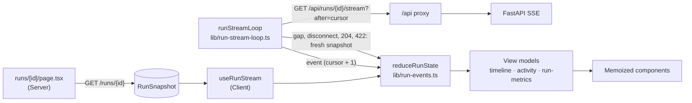

# OpsPilot AI — Frontend Guide

The console is a Next.js 16 App Router app (React 19, TypeScript, Tailwind CSS v4). This page explains how data moves through it, where the server/client boundaries are, and how to make the two most likely changes.

## Where things live

```text
frontend/src
├── app/                        Routes only. Pages and the layout are Server Components.
│   ├── page.tsx                New run (/)
│   ├── runs/page.tsx           Runs list (/runs?page=N)
│   ├── runs/[id]/page.tsx      Run console: loads the snapshot, renders <RunConsole>
│   ├── **/loading.tsx, error.tsx, not-found.tsx
│   └── api/[...path]/route.ts  Same-origin proxy to FastAPI (the browser only calls /api/*)
├── server/data.ts              Server-only loaders: connection(), cache(), errors returned as values
├── features/
│   ├── run-console/            The live console (one client island) and useRunStream
│   ├── tool-views/             Tool call card + registry of per-tool result views
│   ├── runs/                   Runs table, pagination, auto-refresh
│   └── new-run/                Composer, presets, tool catalog, system status, recent runs
├── components/                 Design system (ui/), app shell, markdown, page states
├── hooks/                      Browser hooks: clock, tab visibility, follow-scroll
└── lib/                        React-free logic, unit-tested with `node --test`
```

`lib/` files import each other with explicit `.ts` extensions and use only erasable TypeScript, so Node runs them directly. React code imports them through the `@/` alias.

## Data flow of the run console



1. **Snapshot first.** `runs/[id]/page.tsx` calls `loadRun(id)` (server/data.ts), which fetches `GET /runs/{id}` from `API_INTERNAL_URL`. A 404, or a 422 for a malformed ID, becomes `notFound()`. An outage becomes a "backend unavailable, retry" state.
2. **Client state.** `RunConsole` calls `useRunStream(snapshot)`: a `useReducer` over the pure reducer in `lib/run-events.ts`, started from that snapshot.
3. **Stream from the cursor.** `runStreamLoop` opens `GET /api/runs/{id}/stream?after=<cursor>` with `Last-Event-ID`. Every event must be `cursor + 1`:
   - a duplicate is skipped;
   - a gap loads a fresh snapshot and reconnects from its cursor at once, if the snapshot moved the cursor forward; otherwise it is treated as a disconnect;
   - a disconnect, a frame that does not parse, or a repeated `422` loads a snapshot and retries after 1, 2, 4, 8, then 15 seconds (the count resets only once an event gets through);
   - `204` (finished and caught up) or a terminal event loads the final snapshot and stops;
   - `422` (cursor ahead of the run) forces the server's snapshot.
   The loop is aborted when the component unmounts.
4. **Reducer.** Pure: same input, same output. It replaces only the objects that change, so a text delta creates one new message object and every other turn keeps its identity. A snapshot replaces the state only when it knows more: newer events, or the final numbers of a finished run. An equal snapshot mid-run only refreshes `model_calls`; an older one is ignored.
5. **View models.** `buildTimeline` (trace order), `describeActivity` (the "now" line) and `budgetItems` (meters) are pure functions with unit tests.
6. **Components.** `TurnItem` and `ToolCallCard` are memoized; during streaming a delta re-renders only its own turn.
7. **Commands.** Create, approve/reject and stop are plain `fetch` calls through `/api` (`lib/api.ts`). The open stream delivers their effects, and keyboard focus moves to the result in the trace (the decision record, or the "Run stopped" step). A 409 on an approval reloads the snapshot and explains what happened. No event announces `cancelling`, so a successful Stop applies it locally.

**How tool calls find their turn.** The backend emits a turn's `tool.requested` before that turn's `message.completed`, and `tool.requested` has no `message_id`. The reducer keeps requested calls in `pending_tool_call_ids` and attaches them to the message that completes next, which is how the server groups them. `tests/unit/run-events.test.ts` and `timeline.test.ts` replay the real event order and check that the live trace matches the replayed snapshot.

## Server and client boundaries

| Part | Kind | Why |
| --- | --- | --- |
| `app/layout.tsx` | Server | Reads the theme cookie and renders `<html data-theme>`, so the first byte has the right theme without an inline script. |
| Pages (`/`, `/runs`, `/runs/[id]`) | Server | Load data next to the backend, ship no data-fetching code to the browser, and return expected failures as values (production hides thrown server messages). |
| System status, recent runs | Server, in `<Suspense>` | Stream in after the composer, so a slow backend never blocks first paint. |
| `RunConsole` and everything under it | Client | Every part depends on the live stream. One island keeps the state in one place. |
| Small client leaves | Client | Only where the browser is needed: composer and presets, nav links (pathname), backend status poller, theme toggle, runs auto-refresh, copy buttons, tooltips, tabs, sheet. |

`/runs` refreshes itself with `router.refresh()` every 4 s while any listed run is unfinished, pauses in hidden tabs and stops once every run has finished.

**Security at the boundary.** The browser only talks to `/api/*`. The proxy (`lib/api-proxy.ts`) allowlists backend paths, forwards only `accept`, `content-type` and `last-event-id`, refuses writes whose `Origin` is not the console's own host, and caps request bodies at 64 KB. Run IDs are checked as UUIDs before any request. Model output is rendered with `react-markdown` (no raw HTML, no images, http/https/mailto links only); there is no `dangerouslySetInnerHTML` in the app. `next.config.ts` sends `frame-ancestors 'none'`, `nosniff` and related headers.

## How to add a tool view

1. Create `src/features/tool-views/views/<tool>-view.tsx`. It receives `{ call, data, timeZone }`. Narrow `data` (put any non-trivial parser in `lib/tool-data.ts` with a test) and fall back to JSON:

   ```tsx
   import { asNumber } from "@/lib/json";
   import { JsonBlock } from "../json-block";
   import type { ToolViewProps } from "../types";

   export function WeatherView({ data }: ToolViewProps) {
     const record = data as Record<string, unknown> | null;
     const celsius = asNumber(record?.celsius);
     if (celsius === null) return <JsonBlock value={data} label="result" />;
     return <p className="text-sm">{celsius} °C</p>;
   }
   ```

2. Add one entry to `src/features/tool-views/registry.ts`:

   ```ts
   lookup_weather: { icon: CloudSun, ResultView: WeatherView },
   ```

3. Optional: a one-line summary in `lib/tool-summaries.ts` (`summarizeToolCall` and `summarizeToolResult`), and a row in `lib/tool-catalog.ts` for the new-run page. Without them the card uses a generic `key: value` summary, so a new backend tool never breaks the console.

## How to add a column to the runs table

The table is `src/features/runs/runs-table.tsx` (a Server Component). It renders `RunSummary` items from `GET /runs`; the type is in `lib/api.ts`. Example: an "Updated" column.

1. If the field is new on the backend, add it to `RunSummary` in `lib/api.ts`. `updated_at` is already there.
2. Add a header cell and a body cell. Reuse a formatter from `lib/format.ts`, and hide the column on small screens with the same classes as the other numeric columns:

   ```tsx
   <th scope="col" className="hidden px-4 py-2.5 text-right font-medium md:table-cell">Updated</th>
   // in RunRow
   <td className="hidden px-4 py-3 text-right align-top text-muted md:table-cell">
     {formatRelativeTime(run.updated_at, now)}
   </td>
   ```

3. Nothing else changes: the row link still covers the row, and the skeleton keeps the same row height.

## Checks

```sh
cd frontend
pnpm lint && pnpm typecheck && pnpm test && pnpm build
pnpm test:coverage          # coverage of src/lib
# end-to-end, against the isolated Compose stack (see the README)
E2E_EXTERNAL_STACK=1 pnpm exec playwright test
```

## Known trade-offs

- `loading.tsx` streams the response, so a `notFound()` page keeps HTTP 200 (Next adds `noindex`). The UI is correct; only the status code differs.
- Per-call model usage only arrives in snapshots. The Model calls tab reloads the snapshot when it opens during a live run.
- Active time ticks locally from the server's last checkpoint and is corrected by every snapshot. A client clock behind the server can delay it slightly but never makes it negative.
- The offline `fake` model sends each answer in one chunk, so the streaming caret is only visible with a real model.
- The `/api` proxy starts every stream with an SSE comment (`: connected`). Node sends headers only with the first body chunk, and a caught-up backend stream stays quiet until its 15-second keepalive.
- There is no full Content-Security-Policy yet: Next's inline scripts would need a per-request nonce (set in `proxy.ts`). Only `frame-ancestors` is enforced today.
