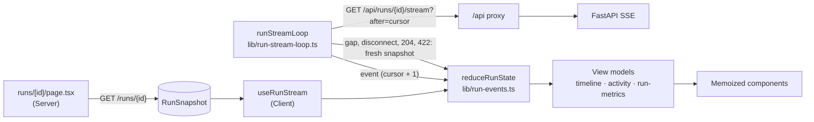
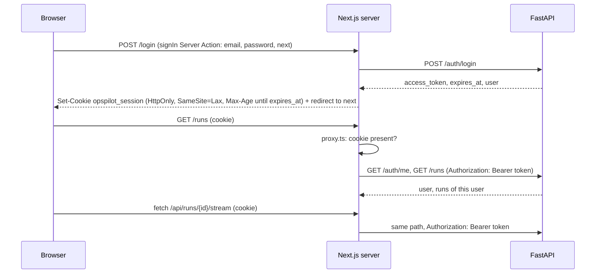

# OpsPilot AI — Frontend Guide

The console is a Next.js 16 App Router app (React 19, TypeScript, Tailwind CSS v4). This page explains how data moves through it, how sign-in works, where the server/client boundaries are, and how to make the two most likely changes.

## Where things live

```text
frontend/src
├── proxy.ts                    Optimistic check: a page request without the session cookie goes to /login
├── app/                        Routes only. Pages and layouts are Server Components.
│   ├── layout.tsx              <html>, theme cookie, skip link (no header: it depends on the session)
│   ├── (console)/layout.tsx    Header with the signed-in user (GET /auth/me) around the console pages
│   ├── (console)/page.tsx      New run (/)
│   ├── (console)/runs/page.tsx Runs list (/runs?page=N), the signed-in user's runs only
│   ├── (console)/runs/[id]/page.tsx  Run console: loads the snapshot, renders <RunConsole>
│   ├── login/                  Sign in (/login?next=…): layout.tsx (signed-out header), page.tsx, actions.ts (signIn, signOut)
│   ├── **/loading.tsx, error.tsx, not-found.tsx
│   └── api/[...path]/route.ts  Same-origin proxy to FastAPI (the browser only calls /api/*)
├── server/
│   ├── session.ts              Reads the session cookie; getCurrentUser() asks GET /auth/me
│   └── data.ts                 Server-only loaders: connection(), cache(), errors returned as values
├── features/
│   ├── auth/                   Sign-in form (useActionState) and the demo accounts
│   ├── run-console/            The live console (one client island) and useRunStream
│   ├── tool-views/             Tool call card + registry of per-tool result views
│   ├── runs/                   Runs table, pagination, auto-refresh
│   └── new-run/                Composer, presets, tool catalog, system status, recent runs
├── components/                 Design system (ui/), app shell (header, user menu), markdown, page states
├── hooks/                      Browser hooks: clock, tab visibility, follow-scroll
└── lib/                        React-free logic, unit-tested with `node --test` (auth.ts: return paths, cookie options)
```

`lib/` files import each other with explicit `.ts` extensions and use only erasable TypeScript, so Node runs them directly. React code imports them through the `@/` alias.

## Data flow of the run console



1. **Snapshot first.** `runs/[id]/page.tsx` calls `loadRun(id)` (server/data.ts), which fetches `GET /runs/{id}` from `API_INTERNAL_URL` with the user's bearer token. A 404 (no such run, or another user's run), or a 422 for a malformed ID, becomes `notFound()`. A 401 redirects to `/login?next=/runs/{id}`. An outage becomes a "backend unavailable, retry" state.
2. **Client state.** `RunConsole` calls `useRunStream(snapshot)`: a `useReducer` over the pure reducer in `lib/run-events.ts`, started from that snapshot.
3. **Stream from the cursor.** `runStreamLoop` opens `GET /api/runs/{id}/stream?after=<cursor>` with `Last-Event-ID`. Every event must be `cursor + 1`:
   - a duplicate is skipped;
   - a gap loads a fresh snapshot and reconnects from its cursor at once, if the snapshot moved the cursor forward; otherwise it is treated as a disconnect;
   - a disconnect, a frame that does not parse, or a repeated `422` loads a snapshot and retries after 1, 2, 4, 8, then 15 seconds (the count resets only once an event gets through);
   - `204` (finished and caught up) or a terminal event loads the final snapshot and stops;
   - `422` (cursor ahead of the run) forces the server's snapshot;
   - `401` (the session ended) stops the loop without retrying and sends the browser to sign in.
   The loop is aborted when the component unmounts.
4. **Reducer.** Pure: same input, same output. It replaces only the objects that change, so a text delta creates one new message object and every other turn keeps its identity. A snapshot replaces the state only when it knows more: newer events, or the final numbers of a finished run. An equal snapshot mid-run only refreshes `model_calls`; an older one is ignored.
5. **View models.** `buildTimeline` (trace order), `describeActivity` (the "now" line) and `budgetItems` (meters) are pure functions with unit tests.
6. **Components.** `TurnItem` and `ToolCallCard` are memoized; during streaming a delta re-renders only its own turn.
7. **Commands.** Create, approve/reject and stop are plain `fetch` calls through `/api` (`lib/api.ts`). The open stream delivers their effects, and keyboard focus moves to the result in the trace (the decision record, or the "Run stopped" step). A 409 on an approval reloads the snapshot and explains what happened. No event announces `cancelling`, so a successful Stop applies it locally. A 401 from any of them (or from a snapshot refresh) goes through `lib/login-redirect.ts`: a full page load of `/login?next=<this page>`. The composer passes `next=/?goal=<goal>` instead, so the goal is back in the box after signing in (line breaks become spaces).

**How tool calls find their turn.** The backend emits a turn's `tool.requested` before that turn's `message.completed`, and `tool.requested` has no `message_id`. The reducer keeps requested calls in `pending_tool_call_ids` and attaches them to the message that completes next, which is how the server groups them. `tests/unit/run-events.test.ts` and `timeline.test.ts` replay the real event order and check that the live trace matches the replayed snapshot.

## Sign-in and the session cookie

The console is a backend-for-frontend: the browser never holds the backend token.



1. **Sign in.** `/login` renders `LoginForm`, a `<form>` bound to the `signIn` Server Action with `useActionState`, so it also works before JavaScript loads. The action checks the fields, calls `POST /auth/login`, stores the token in the `opspilot_session` cookie (`HttpOnly`, `SameSite=Lax`, `Path=/`, `Max-Age` until the backend session expires, `Secure` when the request came over HTTPS) and redirects to `next`. Errors come back as state: a `role="alert"` message that takes keyboard focus. `next` always goes through `safeNextPath` (`lib/auth.ts`), which only accepts a path on this site and never `/login`, so `//evil.com`, `/\evil.com`, `https://…`, `javascript:` and encoded variants fall back to `/`. It also refuses any path the URL parser would change: dot segments (`/.//evil.com` resolves to `//evil.com`) and raw non-ASCII characters (Next writes the redirect into a header, which must be ASCII). The paths the console builds are already in that form.
2. **Pages.** `proxy.ts` redirects page requests without the cookie to `/login?next=<path>` before anything renders. It is only an optimistic check: it reads the cookie and makes no backend call. The real check is FastAPI's. Server code turns the cookie into `Authorization: Bearer <token>` (`server/session.ts`): the console layout (`app/(console)/layout.tsx`) calls `getCurrentUser()` (`GET /auth/me`) for the header, and the loaders send the token. A 401 from a loader becomes `{ kind: "signed-out" }`, and the page redirects to sign in.
3. **Browser calls.** `/api/*` (`app/api/[...path]/route.ts` reads the cookie with Next's parser, `lib/api-proxy.ts` forwards) sends the token as a bearer header. There is no browser-side API override: only this proxy can add the token. It drops any `Authorization` header the browser sent. Without a cookie it answers 401 without calling the backend. Health checks stay public.
4. **Sign out.** The header's user menu posts to the `signOut` Server Action: `POST /auth/logout` revokes the token, then the cookie is deleted and the browser goes to `/login`. The menu (without a name) and its Sign out also appear when `GET /auth/me` fails: then only the cookie is deleted, and the backend session expires on its own.
5. **Stale cookies.** An expired or revoked cookie passes `proxy.ts`, but `/auth/me` and the loaders answer 401. `/login` decides with `getCurrentUser()`, not with the cookie, so it shows the form instead of bouncing back. There is no redirect loop (`tests/auth.spec.ts` puts a revoked cookie back and checks).
6. **Why the header is not in the root layout.** Next keeps a layout across client-side navigations, and a page's `redirect()` during one is handled as a client-side navigation too. The header therefore lives in `app/(console)/layout.tsx` and `app/login/layout.tsx`: going to or from `/login` always swaps the layout, so the header is rendered again for the new session state.

Another user's run answers 404, exactly like a run that does not exist, so a run ID reveals nothing.

## Server and client boundaries

| Part | Kind | Why |
| --- | --- | --- |
| `proxy.ts` | Server (before routing) | Redirects page loads without a session cookie to `/login`. Cookie check only, no backend call. |
| `app/layout.tsx` | Server | Reads the theme cookie and renders `<html data-theme>`, so the first byte has the right theme without an inline script. |
| `app/(console)/layout.tsx`, `app/login/layout.tsx` | Server | The header (`PageShell`) and `<main>`. The console layout calls `getCurrentUser()`; the sign-in layout always shows the signed-out header. |
| `app/login/actions.ts` | Server (Server Actions) | `signIn` and `signOut`. The token goes from FastAPI into the HttpOnly cookie and never reaches browser JavaScript. |
| Sign-in form, sign-out button | Client | `useActionState` / `useFormStatus` for pending and error states. Both forms also work without JavaScript. |
| User menu | Server | A native `popover` panel: the browser handles open, close, Escape and focus order, with no client JavaScript. |
| Pages (`/`, `/runs`, `/runs/[id]`) | Server | Load data next to the backend, ship no data-fetching code to the browser, and return expected failures as values (production hides thrown server messages). |
| System status, recent runs | Server, in `<Suspense>` | Stream in after the composer, so a slow backend never blocks first paint. |
| `RunConsole` and everything under it | Client | Every part depends on the live stream. One island keeps the state in one place. |
| Small client leaves | Client | Only where the browser is needed: composer and presets, nav links (pathname), backend status poller, theme toggle, runs auto-refresh, copy buttons, tooltips, tabs, sheet. |

`/runs` refreshes itself with `router.refresh()` every 4 s while any listed run is unfinished, pauses in hidden tabs and stops once every run has finished.

**Security at the boundary.** The browser only talks to `/api/*`. The proxy (`lib/api-proxy.ts`) allowlists backend paths (not `/auth`), forwards only `accept`, `content-type` and `last-event-id`, adds `Authorization: Bearer <token>` from the session cookie (never the browser's own `Authorization` or `Cookie`), answers 401 without a session, refuses writes whose `Origin` is not the console's own host, and caps request bodies at 64 KB. Cross-site requests are blocked twice: `SameSite=Lax` keeps the cookie off other sites' POSTs, and both the proxy and Next's Server Actions compare `Origin` with the host. Run IDs are checked as UUIDs before any request. Model output is rendered with `react-markdown` (no raw HTML, no images, http/https/mailto links only); there is no `dangerouslySetInnerHTML` in the app. `next.config.ts` sends `frame-ancestors 'none'`, `nosniff` and related headers.

## How to add a tool view

1. Create `src/features/tool-views/views/<tool>-view.tsx`. It receives `{ call, data, timeZone }`. Narrow `data` (put any non-trivial parser in `lib/tool-data.ts` with a test) and fall back to JSON:

   ```tsx
   import { asNumber } from "@/lib/json";
   import { JsonBlock } from "../json-block";
   import type { ToolViewProps } from "../types";

   export function WeatherView({ data }: ToolViewProps) {
     const record = data as Record<string, unknown> | null;
     const celsius = asNumber(record?.celsius);
     if (celsius === null) return <JsonBlock value={data} label="result" />;
     return <p className="text-sm">{celsius} °C</p>;
   }
   ```

2. Add one entry to `src/features/tool-views/registry.ts`:

   ```ts
   lookup_weather: { icon: CloudSun, ResultView: WeatherView },
   ```

3. Optional: a one-line summary in `lib/tool-summaries.ts` (`summarizeToolCall` and `summarizeToolResult`), and a row in `lib/tool-catalog.ts` for the new-run page. Without them the card uses a generic `key: value` summary, so a new backend tool never breaks the console.

## How to add a column to the runs table

The table is `src/features/runs/runs-table.tsx` (a Server Component). It renders `RunSummary` items from `GET /runs`; the type is in `lib/api.ts`. Example: an "Updated" column.

1. If the field is new on the backend, add it to `RunSummary` in `lib/api.ts`. `updated_at` is already there.
2. Add a header cell and a body cell. Reuse a formatter from `lib/format.ts`, and hide the column on small screens with the same classes as the other numeric columns:

   ```tsx
   <th scope="col" className="hidden px-4 py-2.5 text-right font-medium md:table-cell">Updated</th>
   // in RunRow
   <td className="hidden px-4 py-3 text-right align-top text-muted md:table-cell">
     {formatRelativeTime(run.updated_at, now)}
   </td>
   ```

3. Nothing else changes: the row link still covers the row, and the skeleton keeps the same row height.

## Checks

```sh
cd frontend
pnpm lint && pnpm typecheck && pnpm test && pnpm build
pnpm test:coverage          # coverage of src/lib
# end-to-end, against the isolated Compose stack (see the README)
E2E_EXTERNAL_STACK=1 pnpm exec playwright test
```

Playwright's `setup` project (`tests/auth.setup.ts`) signs in Alex and Sam through the form and saves their cookies under `tests/.auth/` (git-ignored). Specs run as Alex by default; `tests/auth.spec.ts` (which also uses signed-out and Sam's browsers) covers the signed-out redirect, a wrong password, sign-out, per-user runs and axe on `/login`. The password is `E2E_DEMO_PASSWORD`, default `opspilot-demo`.

## Known trade-offs

- `loading.tsx` streams the response, so a `notFound()` page keeps HTTP 200 (Next adds `noindex`). The UI is correct; only the status code differs.
- Per-call model usage only arrives in snapshots. The Model calls tab reloads the snapshot when it opens during a live run.
- Active time ticks locally from the server's last checkpoint and is corrected by every snapshot. A client clock behind the server can delay it slightly but never makes it negative.
- The offline `fake` model sends each answer in one chunk, so the streaming caret is only visible with a real model.
- The `/api` proxy starts every stream with an SSE comment (`: connected`). Node sends headers only with the first body chunk, and a caught-up backend stream stays quiet until its 15-second keepalive.
- There is no full Content-Security-Policy yet: Next's inline scripts would need a per-request nonce (set in `proxy.ts`). Only `frame-ancestors` is enforced today.
- The console layout waits for `GET /auth/me` before it streams, about one local round trip per page load. The header needs the user, and `cache()` shares the call with the page.
- `proxy.ts` cannot tell a stale cookie from a valid one (the token is opaque, and checking it would cost a backend call on every request). Pages catch stale cookies with a 401, and the cookie stays until the next sign-in or sign-out. Its `Max-Age` already ends it with the backend session.
- A Server Action's `previous` state comes from the client, so `failedSignIn` does not trust it. The real limit on guessing passwords is the backend's login throttle.
- Moving between console pages reuses the console layout, so if another tab signs in as someone else, this tab's header shows the old name until the next full page load. The data is still the new user's: every request carries the shared cookie.
- When the session ends, unsent text in the reject form is lost; only the composer's goal comes back after signing in. A goal whose encoded form passes 4096 characters (long non-Latin text) is not restored either.
- Sessions last 12 hours from sign-in (backend `session_ttl_hours`), with no warning before they end.
- Errors on `/login` itself fall through to `global-error.tsx`; the console pages have their own `error.tsx` boundaries inside the console layout, so the header stays.
