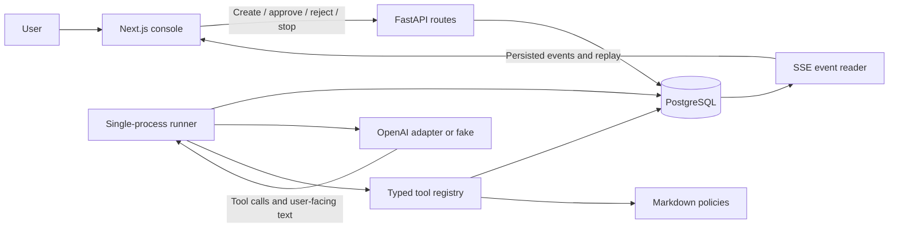
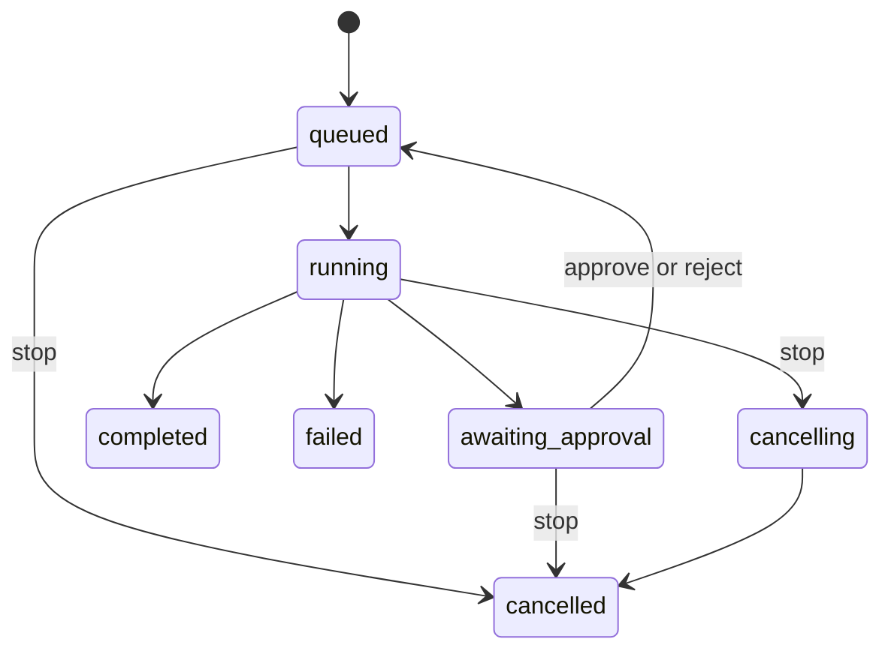

# OpsPilot AI Implementation Plan

Run one numbered phase per user request. “Phase N complete করো” selects the matching section below. Inspect prior phase evidence and the current repository, implement the selected scope, run its checks, and fix failures within that scope. Record the status below and report what changed, the check results, remaining blockers, and the next phase number. Stop at that boundary until the user requests the next phase.

| Phase | Deliverable | Suggested GPT 6.2 reasoning effort | Status |
| --- | --- | --- | --- |
| 1 | Local runtime and API contracts | High | Complete · 20 Nov 2026. All three services healthy, Chrome connected, database outage and recovery verified. |
| 2 | PostgreSQL migrations and repeatable demo fixtures | High | Planned |
| 3 | Four typed tool contracts and read tools | High | Planned |
| 4 | Native OpenAI loop, fake provider, persistence and usage | Extra High | Planned |
| 5 | Durable approval, refund transaction and cancellation | Extra High | Planned |
| 6 | Incremental SSE, replay and reconnect | Extra High | Planned |
| 7 | Next.js console, approval card and history | High | Planned |
| 8 | Reliability tests, browser journey and CI | Extra High | Planned |
| 9 | Fresh Docker startup and UI polish | High | Planned |
| 10 | README, walkthrough, recording and submission package | High | Planned |

Effort settings are planning suggestions for the choices available in your Codex session. Use Ultra selectively when a reproducible concurrency or replay defect remains unresolved. Choose the application model independently through backend configuration.

Mark a phase complete only after its exit check passes. If a check is blocked, record which behavior remains unverified. Keep a short verification note or local commit reference in the status cell so another Codex session can continue from evidence. For final delivery, record the actual video and distinguish local submission readiness from repository sharing and sending the links. The latter actions require the user's explicit instruction with the destination.

**Goal:** Deliver a professional local Agent Run Console with a real OpenAI tool loop, live trace, durable human approval, PostgreSQL history, tests, and a reproducible Docker demo within the user's three-day window.

**Architecture:** A Next.js frontend talks to an asynchronous FastAPI backend. A small native tool-calling loop runs independently of browser connections; PostgreSQL stores runs, messages, tool calls, approvals, usage, and replayable events. For this local submission, one API process owns a lifespan-managed runner; explicitly document that arbitrary in-flight model calls are not automatically resumed after a backend crash.

**Tech Stack:** Next.js App Router and TypeScript; Tailwind CSS and a small accessible component set; Python 3.12; FastAPI and Pydantic v2; SQLAlchemy 2.0 async and asyncpg; Alembic; PostgreSQL; OpenAI Python SDK; pytest and HTTPX; Playwright; Docker Compose; pnpm and uv. Pin supported patched dependency versions and lockfiles during setup rather than guessing version numbers in this plan.

## Global Constraints

The following version floors and requirements come from the supplied brief:

- "Frontend: Next.js 14 or later with the App Router and TypeScript."
- "Backend: FastAPI on Python 3.11 or later, with async endpoints and Pydantic v2 models."
- "Database: PostgreSQL through SQLAlchemy 2.0, with Alembic migrations. SQLite is fine for tests only."
- "LLM: any provider (OpenAI, Anthropic, Gemini, or a local model through Ollama). Put the model behind an interface so a fake model can be used in tests."
- "Agent framework: LangGraph, or your own loop using the provider's native tool calling. Either is fine; be ready to explain your choice."
- "One-command start. docker compose up starts the frontend, backend and database."
- At least four tools: `query_orders`, `search_policies`, `date_math` or `calculator`, and approval-gated `issue_refund`.
- Store every run, message, and tool call; stream model text and tool steps; implement rejection reasons, Stop, history, tokens, cost, and the specified failure paths.
- Deliver a GitHub repository with meaningful commits, the specified README, and a 5–10 minute recording.

## Source and authorization

Source: `/Volumes/HDD/Downloads/Midu_Take-Home_Project.docx`, read completely on 19 November 2026. The document describes an interview assignment. Its instructions to email an estimate, share a repository, and send a recording are submission requirements, not authorization for this assistant to send messages or publish anything.

The user has selected OpenAI API, local Docker plus GitHub delivery, and a three-day window with 12–14 hours available daily. The current workspace contains only `README.md`, `.gitignore`, and an initial Git commit. No application exists. The referenced `docs/CODEX-NAVIGATION-GUIDE.md` is absent; there are no existing application conventions to preserve.

Local preflight found Node, pnpm, npm, and uv. The system `python3` is 3.9.6, so use a project-managed Python 3.12 or the backend container. Docker CLI and common Docker/OrbStack installation paths were not found; installing and starting a Docker runtime is an early dependency. This observation does not prove no alternative runtime exists elsewhere.

## Product understanding

The user enters an operations goal. The model chooses tools, receives their results, and continues until a final response or a guard stops the run. The console shows the actual execution trace. A write proposal pauses execution and requires a human decision before the backend can perform it.

The example goal, "Find orders over $500 that shipped late last month and draft a refund email for each," is a read-and-draft request. It must not create a refund. A separate explicit refund goal demonstrates approval and the `issue_refund` tool. Emails are drafts in the final response; email delivery is outside the required scope.

`issue_refund` performs a real database write to a **simulated refund ledger**, clearly labeled in the UI and README. It does not move money. Synthetic orders and fictional policies are sufficient; no customer data or payment account is needed.

The highest-priority assessment areas are tool design, streaming, and approval pause/resume. Code clarity and the user's ability to explain and modify it are also explicit assessment criteria.

## Decisions and tradeoffs

| Decision | Choice | Reason and limit |
| --- | --- | --- |
| Agent orchestration | Small native tool loop | Four tools and one approval boundary are explainable without framework-specific checkpoint behavior. We own state and tests explicitly. |
| Provider | OpenAI Responses API behind `LLMProvider` plus `FakeProvider` | One real adapter keeps scope controlled; tests need no paid API. Persist local transcript and required continuation items rather than depending on server-side conversation storage. Other providers are extension points, not current deliverables. |
| Browser transport | SSE plus HTTP commands | Events flow backend to browser; approve/reject/stop are POST requests. Reconnection uses a persisted cursor. |
| Execution ownership | One FastAPI process with lifespan runner | Three-service Compose and low implementation overhead. Do not deploy with multiple API workers. |
| Durable storage | PostgreSQL for all application state | Browser refresh and pending approval do not depend on browser memory or a suspended coroutine. |
| Policy retrieval | Deterministic keyword search over eight Markdown files | Meets the brief without embeddings, indexing infrastructure, or another API key. |
| Refunds | Local transactional ledger | Demonstrates an approval-gated write, exact amounts, and idempotency without payment integration. |
| Authentication | Single-user local baseline | Login is optional. Bind local services to loopback; public deployment would require a new access-control scope. |
| Frontend state | Typed API snapshot plus event reducer | Keep live client state small; do not add a global state framework unless a concrete need appears. |

LangGraph is a valid alternative with durable interrupts, but it does not eliminate application-level approval validation, refund idempotency, or event persistence. The native loop is chosen for the short deadline and live-code-change assessment.



## Domain rules

- One fictional currency: USD. Represent monetary amounts as integer cents, never binary floating-point values.
- "Over $500" means `amount_minor > 50000`, excluding exactly $500.
- "Shipped late" means `shipped_at > promised_ship_at`; delivery lateness is a different concept.
- "Last month" filters `shipped_at` using the previous calendar month, with an inclusive start and exclusive end.
- Use a configurable business timezone, default UTC, and save the run-start reference time. User scheduling remains Asia/Dhaka; the fictional business timezone is a separate setting.
- Seed approximately 30 orders across qualifying/nonqualifying cases: below/equal/above threshold, early/on-time/late shipments, month boundaries, cancelled and already-refunded orders.
- Seed relative to an explicit reference date stored in seed metadata. Show that date and matching demo prompts; refreshing fixtures is an explicit development command, never a silent overwrite.
- Eight policies cover shipping commitments, late-shipment eligibility, refund amounts, exclusions, partial refunds, duplicate requests, email tone, and escalation.
- Proposed fictional rule: qualifying late shipments receive 10% of order value capped at $100, subject to exclusions. Round fractional cents with ROUND_HALF_UP using integer arithmetic or Decimal; include a half-cent boundary test. A deterministic refund validator enforces the documented rule, remaining balance, and currency. The model cannot invent eligibility or amounts.
- A policy-backed refund is unique per order and policy version for this demo. This prevents an equivalent second request under a new model tool-call ID as well as replay of the same call.
- Retrieved policies and customer fields are data, not instructions that can bypass application permissions.

## Backend contracts

### Data model

| Table | Main fields and constraints |
| --- | --- |
| `runs` | UUID, goal, status, provider/model, reference time/timezone, model/tool counters and limits, active elapsed milliseconds, execution cursor, cancellation flag, timestamps, next event sequence |
| `messages` | Run ID, ordered index, role, text, provider continuation payload, completion status; unique run/index |
| `tool_calls` | Run/message IDs, provider call ID, name, immutable arguments, status, result/error, timestamps |
| `approvals` | Run/tool-call IDs, proposed-argument digest, pending/approved/rejected/cancelled, reason, decision time; unique tool call |
| `run_events` | Run ID, sequence, type, schema version, timestamp, JSON payload; unique run/sequence |
| `model_calls` | Attempt ID, model, status, input/output/cached usage when reported, pricing snapshot, estimated cost, usage completeness |
| `orders` | Synthetic customer details, USD amount, promised/actual shipment timestamps, status |
| `refunds` | Order and tool-call IDs, policy version, amount, currency, reason, timestamp; unique tool call and business refund key |

Messages and model continuation data must preserve provider call IDs and any opaque continuation items needed by the selected API. Do not display private reasoning content as the timeline. Timeline text is user-facing model output, arguments, results, decisions, and errors.

The event log supports UI replay; relational records remain the authoritative domain state. This is not a general event-sourcing framework. Use short transactions and a separate `AsyncSession` for each concurrent operation. Never hold a transaction open while awaiting the model or human input.

### State machine and execution



- `POST /runs` atomically creates the run, user message, and queued event; it does not wait for the model.
- The lifespan runner polls persisted queued work and atomically claims one run at a time. One active run is enough for this local version; other runs show queued status.
- Each model request consumes one persisted step, including failed attempts. Start with 20 model turns, 40 total tool calls, a 60-second model-call timeout, and a five-minute active execution budget, all configurable. Human approval wait is excluded from active execution time. Persist cumulative counters and active elapsed time across approval requeues; resuming must not reset any budget.
- Disable SDK automatic retries initially so application step and timeout behavior remain visible. Errors return a clear failed run; malformed tool arguments and ordinary tool failures produce structured observations so the model can recover within the remaining budget.
- Process complete tool calls serially. Prefer `parallel_tool_calls=false`, but still validate and safely process a returned list without dropping calls. Do not start another model turn before all issued calls have a result, unless the run is paused or terminal.
- Before pausing, persist the exact tool call, approval, transcript, and next execution position, then release the runner. Approval requeues that saved position; it does not regenerate the proposal.
- At startup, process queued runs and preserve pending approvals. Mark abandoned `running` runs failed with `PROCESS_RESTARTED`; finalize abandoned `cancelling` runs as cancelled. Preserve their trace and committed writes. Do not promise transparent resumption of partially streamed model calls.

### API

| Endpoint | Behavior |
| --- | --- |
| `POST /runs` | Validate goal and size; persist and return `202` with run ID/status |
| `GET /runs` | Paginated summaries: status, step count, tokens, estimated cost, duration |
| `GET /runs/{id}` | Consistent persisted snapshot, complete trace, pending approval, and snapshot event cursor |
| `GET /runs/{id}/stream` | Read-only SSE replay/tail; never starts or resumes execution |
| `POST /runs/{id}/approve` | Accept approval ID, decision, optional reason; require nonblank reason for rejection |
| `POST /runs/{id}/stop` | Idempotent cancellation request; disable further work |
| `GET /health/live` | Process liveness |
| `GET /health/ready` | Database and migration readiness |

Approval input is `{ "approval_id": "uuid", "decision": "approve|reject", "reason": "text or null" }`. The browser cannot submit new refund arguments. Use `404` for missing resources, `422` for invalid input, and `409` for a stale/conflicting decision. An identical repeated decision returns the stored result.

### Approval and refund invariants

1. The backend gates `issue_refund`, even if the UI is bypassed or the model claims approval.
2. A decision binds to one pending approval and exact saved arguments; changed arguments require a new approval.
3. Approve/reject atomically decides the pending record and requeues the run.
4. Rejection generates a tool observation containing the reason, then the model continues without a write.
5. Refund execution locks run and order rows in a consistent order, checks cancellation and approval, revalidates eligibility/balance, and commits refund, tool result, and events together.
6. Unique tool-call and business-refund keys prevent duplicate effects across clicks, replay, and equivalent calls.
7. Stop uses the same run-row locking boundary. If Stop wins, no subsequent refund commits. A refund committed before Stop remains visible and is not silently reversed.
8. Stopping a browser stream only disconnects that viewer. It never cancels the run.
9. Completion and failure transitions recheck cancellation under the run lock; a late model response cannot turn a cancelled run into a completed run.

### SSE and accounting

- Event envelope: `{ schema_version: 1, run_id, sequence, type, occurred_at, payload }`.
- Types: `run.queued`, `run.started`, `message.delta`, `message.completed`, `tool.requested`, `tool.started`, `tool.completed`, `tool.failed`, `approval.required`, `approval.decided`, `usage.updated`, `run.completed`, `run.failed`, `run.cancelled`.
- Persist before publishing; allocate sequence under the same run-row transaction lock as event insertion. Batch short text chunks for approximately 100 ms to avoid one write per token.
- Support `Last-Event-ID` and `?after=N`. Return a consistent snapshot and cursor, then read only events after that cursor. The client deduplicates by sequence.
- Tail by polling the indexed event log initially. Keepalive comments, nonbuffered SSE responses, bounded batches, and connection cleanup are required. Close on terminal state after draining its events.
- Cost is estimated from reported usage and a stored model/pricing snapshot, including cached-token pricing if applicable. Use decimal arithmetic for costs. Interrupted usage is marked incomplete/unknown, not falsely reported as zero.
- Show total elapsed duration and approval waiting time separately where useful. Do not display a paused run as actively consuming model time.
- Use structured logs with run/tool/request IDs, duration, and error codes. Do not log credentials or full customer/prompt payloads by default.

## Frontend design

Use a restrained operations console with clear typography, consistent spacing, a compact navigation sidebar, readable timelines, and a visible run status. Product copy is English. Prefer an excellent desktop layout with responsive narrow-screen behavior over adding a theme system.

| Screen or component | Required behavior |
| --- | --- |
| New run | Goal input, draft-only and explicit-refund examples, submit/loading/error states |
| Run console | Live user-facing text, expandable tool arguments/results, status, steps, tokens, cost, duration, Stop |
| Approval card | Order/customer, amount/currency, reason/policy evidence, simulated-action label, Approve and Reject with reason |
| Run history | Paginated past runs with status/steps/tokens/duration and links to full traces |
| Replayed run | Same trace presentation reconstructed from stored data, including decisions and failures |

Use Server Components for initial page/snapshot fetching and Client Components for streaming, the input, and buttons. Disable repeated clicks locally while the server remains authoritative. Loading, empty, paused, failed, cancelled, completed, offline/reconnecting, and stale-approval states must be designed.

Preserve reading position during long traces; auto-scroll only when near the bottom. Use keyboard-accessible disclosure controls, labeled forms, visible focus, adequate contrast, and status labels that do not rely only on color. Announce status changes without having a screen reader speak every streamed token. Render model Markdown without raw HTML execution.

## Proposed file ownership

```text
compose.yaml                         frontend, backend, database, healthchecks, volume
.env.example                         documented nonsecret local configuration
backend/pyproject.toml                dependencies, test/lint/typecheck settings
backend/uv.lock                      reproducible Python dependencies
backend/Dockerfile                   pinned Python runtime
backend/alembic.ini                  migration configuration
backend/alembic/versions/            schema migrations
backend/app/main.py                  app setup and runner lifespan
backend/app/config.py                validated environment settings
backend/app/db.py                    async engine/session factory
backend/app/models.py                initial relational model definitions
backend/app/seed.py                  idempotent synthetic fixtures
backend/app/runs/schemas.py          run, action, and event DTOs
backend/app/runs/routes.py           HTTP endpoints
backend/app/runs/service.py          state transitions and approval/stop transactions
backend/app/runs/events.py           event append, snapshot, and tail
backend/app/agent/contracts.py       provider messages and model events
backend/app/agent/providers.py       OpenAI adapter and deterministic fake
backend/app/agent/loop.py            bounded tool loop
backend/app/agent/runner.py          persisted queue ownership and startup handling
backend/app/agent/prompts.py         concise agent instructions and tool boundaries
backend/app/agent/usage.py           usage normalization and cost estimates
backend/app/tools/registry.py        tool metadata and validation dispatch
backend/app/tools/query_orders.py    strict read-only filters
backend/app/tools/search_policies.py deterministic file search and evidence
backend/app/tools/date_math.py       calendar operations with injected clock
backend/app/tools/issue_refund.py    eligibility and transactional simulated write
backend/policies/                    eight fictional Markdown documents
backend/tests/conftest.py            fake/provider, isolated Postgres, API fixtures
backend/tests/unit/                 tools, loop, event envelope, cost tests
backend/tests/integration/          Postgres/API approval, cancellation, SSE tests
frontend/src/app/page.tsx            new-run screen
frontend/src/app/runs/page.tsx       run history
frontend/src/app/runs/[id]/page.tsx  initial run snapshot
frontend/src/components/run-console.tsx  live run controls
frontend/src/components/run-timeline.tsx trace presentation
frontend/src/components/approval-card.tsx decision form
frontend/src/lib/api.ts             typed HTTP boundary
frontend/src/lib/run-events.ts      sequence-aware event reducer
frontend/tests/                    reducer/component tests and Playwright journeys
docs/architecture.md                decisions, state machine, known limits
docs/demo-script.md                 recording and walkthrough rehearsal
.github/workflows/ci.yml            local-equivalent checks when repository is pushed
README.md                          setup, diagram, decisions, gaps, next steps
```

Keep modules focused. Split `models.py` or `providers.py` if they become difficult to review; avoid introducing layers whose only role is forwarding a call.

## Three-day implementation sequence

The schedule is an aggressive **36–42 focused hours**, not a guaranteed completion claim. The base estimate below is 36 hours, with up to six hours of contingency. If work starts on 19 November, the target is 22 November 2026 in Asia/Dhaka; confirm the actual cutoff time before making an external commitment. Protect the final testing and recording block.

| Day | Phases | Base time | Exit condition |
| --- | --- | --- | --- |
| 1 | 1–4 | 12 h | Reproducible foundation, seeded tools, genuine OpenAI loop with stored trace |
| 2 | 5–7 | 12 h | Approval/rejection/Stop and reconnecting console work end to end |
| 3 | 8–10 | 12 h | Reliability checks pass, cold start verified, README and recording ready |

Implement and verify phases in sequence. Use the API contracts from Phase 1 for frontend fixtures in Phase 7. Run the first real-provider integration on Day 1 and the first live HTTP streaming check on Day 2.

**Shared implementation gate:** Write meaningful behavior tests with each change, run relevant checks, and review the diff before committing. Run frontend dependency audit (`pnpm audit`, the package-manager equivalent of `npm audit`) and Python `uv run pip-audit` before implementation commits, as required by the user's repository guidance. Explain unresolved findings rather than hiding audit failures. The suggested commits below are future milestones, not permission to push or share the repository.

**Early checkpoints:** By hour 4, verify OpenAI credentials with a minimal tool-call round trip and confirm PostgreSQL migrations/seed. By hour 12, the real persisted loop must work. Freeze features by approximately hour 26 and spend the remaining time on defects, verification, documentation, and recording.

### Phase 1 Establish contracts and local runtime

**Time:** 2 hours. **Files:** `compose.yaml`, `.env.example`, both package manifests/lockfiles and Dockerfiles, `backend/app/config.py`, `backend/app/main.py`, `backend/app/runs/schemas.py`, `backend/app/agent/contracts.py`, `frontend/src/lib/api.ts`.

**Consumes:** User decisions and the brief. **Produces:** Config, event/state schemas, empty healthy services, provider interface. The provider interface is `LLMProvider.stream_turn(messages, tool_definitions) -> AsyncIterator[ModelEvent]`; normalized model events are text deltas, complete tool calls, usage, and turn completion. A turn may contain multiple calls. The fake accepts a scripted list of model turns and captures its received messages.

- [x] Verified the Docker/Colima runtime, Python 3.12, Node 24 container and package managers. OpenAI account quota and model access remain unverified until a key is configured for the Phase 4 real-provider check.
- [x] Pin versions; use FastAPI's built-in SSE response if the selected version supports it. Commit lockfiles, not floating production dependencies.
- [x] Define states, tool/error envelopes, snapshot cursor, and API DTOs before parallel frontend work.
- [x] Add liveness/readiness and Compose health dependencies. Name the services `frontend`, `backend`, and `db`; use one Uvicorn worker. Keep secrets backend-only and ports bound to loopback. Configure the browser API URL as `http://localhost:8000`, server-side API URL as `http://backend:8000`, and an explicit allowed browser origin of `http://localhost:3000`.
- [x] Confirm the following smoke check returns `200` after database readiness:

```bash
docker compose up --build -d
curl --fail http://localhost:8000/health/ready
```

**Gate:** Frontend shell, FastAPI, and PostgreSQL boot together; readiness distinguishes an unavailable database. Suggested commit: `chore: establish application contracts and docker runtime`.

### Phase 2 Persist the domain and seed the scenario

**Time:** 3 hours. **Files:** `backend/app/db.py`, `backend/app/models.py`, `backend/alembic/`, `backend/app/seed.py`, `backend/app/runs/service.py`, `backend/tests/conftest.py`, `backend/tests/integration/test_persistence.py`.

**Consumes:** Phase 1 state/DTO contracts. **Produces:** Migrations, isolated database fixture, run CRUD, seed data, and transactional event append. The `seed_data` fixture exposes seeded orders and a reference clock; `db_session` creates a fresh async session; API tests override dependencies to use an isolated Postgres database.

- [ ] Write a persistence test that creates a run, closes its session, opens a new session, and reads the same initial user message and status.
- [ ] Add migration constraints for unique event sequence, approval/tool-call associations, and duplicate refund keys.
- [ ] Add idempotent seeding with a recorded reference date and the eight policy files.
- [ ] Test repeated seed execution preserves existing refunds/runs and does not duplicate orders.
- [ ] Run migrations on a fresh database and run the integration test:

```bash
cd backend
uv run alembic upgrade head
uv run pytest tests/integration/test_persistence.py -q
```

**Gate:** Data survives a backend restart; migrations rebuild an empty database; seeding is nondestructive. Suggested commit: `feat: persist runs and seed operations data`.

### Phase 3 Implement four typed tools

**Time:** 3 hours. **Files:** `backend/app/tools/`, `backend/policies/`, `backend/tests/unit/test_tools.py`, `backend/tests/integration/test_order_queries.py`.

**Consumes:** Seed data and async session factory. **Produces:** Registry entries with name, description, Pydantic argument schema, read/write metadata, and async executor. `issue_refund` is registered as approval-required; direct unapproved execution fails. Its successful write path is completed in Phase 5.

- [ ] Write tests for $500 exclusion, calendar-month boundaries, pagination, invalid filters, policy no-match, timezone handling, and missing approval.
- [ ] Implement `query_orders` through predefined SQLAlchemy predicates; disallow extra fields, SQL strings, unbounded limits, and arbitrary sorts.
- [ ] Implement keyword search with stable ranking and policy ID/title/excerpt/version results; restrict paths to the bundled corpus.
- [ ] Implement `date_math` for previous-calendar-month boundaries and deterministic date differences. Use an injected reference clock.
- [ ] Implement deterministic refund-rule validation against the documented fictional policy; do not trust a model-supplied eligible flag.
- [ ] Run the tool and database-query tests. A representative boundary assertion is:

```python
def test_previous_month_is_calendar_month():
    from datetime import date
    from app.tools.date_math import previous_month

    assert previous_month(date(2026, 11, 19)) == (date(2026, 10, 1), date(2026, 11, 1))
```

**Gate:** Four tools have strict contracts; reads are read-only; invalid write attempts cannot create a refund. Suggested commit: `feat: add typed operations tools and policy evidence`.

### Phase 4 Build and test the genuine model loop

**Time:** 4 hours. **Files:** `backend/app/agent/`, `backend/tests/unit/test_agent_loop.py`, `backend/tests/unit/test_usage.py`, `backend/tests/integration/test_runner.py`.

**Consumes:** Provider interface, registry, persistence. **Produces:** Real OpenAI adapter, scripted fake, bounded runner, usage records, and saved transcript. Selected OpenAI model must support function calling and streaming in the actual account; keep the model ID in configuration.

- [ ] First test a fake turn that calls `date_math`, a second turn that consumes the tool result and calls `query_orders`, and a final text turn. Assert actual returned results are present in the next provider input.
- [ ] Test malformed arguments, an unknown tool, a tool exception, repeated calls reaching the step limit, empty output, and model timeout.
- [ ] Implement persisted model-turn counting and serial tool execution. Every complete provider call gets a corresponding stored result or a pending approval.
- [ ] Implement the lifespan-managed queue with a single runner and the documented startup recovery behavior.
- [ ] Implement the OpenAI streaming adapter and normalized usage/cost. Test missing usage as unknown and cached-token accounting without double counting.
- [ ] Run a real low-cost smoke goal using the selected model; verify it chooses a tool without a hardcoded scenario sequence.

```bash
cd backend
uv run pytest tests/unit/test_agent_loop.py tests/unit/test_usage.py tests/integration/test_runner.py -q
```

**Gate:** Day 1 ends with a real provider working and a persisted trace; the fake is used only for deterministic development/tests. Suggested commit: `feat: add bounded agent runner with openai and fake providers`.

### Phase 5 Complete durable approvals and Stop

**Time:** 4 hours. **Files:** `backend/app/runs/service.py`, `backend/app/runs/routes.py`, `backend/app/tools/issue_refund.py`, `backend/tests/integration/test_approvals.py`, `backend/tests/integration/test_cancellation.py`.

**Consumes:** Saved loop cursor and pending tool call. **Produces:** Approve/reject/resume and cancellation, with one transactional simulated refund. Fixtures `paused_run`, `api_client`, and `refund_repository` respectively create a pending fake-driven run, an HTTP client, and a database reader; they must not bypass the production approval service.

- [ ] Write tests proving zero refund before approval and after rejection, including the exact rejection reason in the next model input.
- [ ] Add tests for duplicate identical decisions, conflicting decisions, stale approvals, changed arguments, exhausted balance, and equivalent refunds under different call IDs.
- [ ] Implement decisions using row locks and persisted state transitions; requeue the saved action rather than replaying the whole model turn.
- [ ] Implement the refund transaction and Stop with the shared lock ordering. Cancel active provider work cooperatively and check cancellation again before every tool side effect.
- [ ] Test refresh and a backend restart while awaiting approval, then approve successfully. Verify model/tool/time budgets retain their already-consumed values after resume.
- [ ] Test Stop during generation, queued work, waiting approval, and a refund race. Verify already-committed actions remain in the history.

```bash
cd backend
uv run pytest tests/integration/test_approvals.py tests/integration/test_cancellation.py -q
```

**Gate:** No UI, model, retry, or second tab can bypass approval or duplicate the ledger effect. Suggested commit: `feat: add durable approval decisions and safe cancellation`.

### Phase 6 Expose replayable incremental SSE

**Time:** 3 hours. **Files:** `backend/app/runs/events.py`, `backend/app/runs/routes.py`, `backend/tests/integration/test_streaming.py`.

**Consumes:** Persisted events and consistent snapshots. **Produces:** Incremental SSE with cursors and no execution ownership. A `live_api_server` test fixture starts Uvicorn on an ephemeral local port; a controllable fake model emits an early event and waits for a test signal before completing.

- [ ] Write a real-network test that receives an event while the fake is still blocked. Only then release the fake and assert the terminal event. This proves streaming rather than buffered response parsing.
- [ ] Assert `text/event-stream`, ordered IDs, replay from an earlier cursor, terminal closure, and clean client disconnect.
- [ ] Implement snapshot/cursor consistency, committed event reads, keepalives, and bounded polling batches.
- [ ] Connect two subscribers and assert only one model execution; reconnect and assert no missing or duplicated logical timeline entries.
- [ ] Confirm UI/backend connections work through the actual Compose networking path, with browser-visible and server-internal API URLs distinguished.

```bash
cd backend
uv run pytest tests/integration/test_streaming.py -q
```

**Gate:** An event is visible before run completion, and refresh/reconnection does not execute work twice. Suggested commit: `feat: stream and replay persisted run events`.

### Phase 7 Integrate the professional console

**Time:** 5 hours, with shell/layout work optionally started earlier. **Files:** `frontend/src/app/`, `frontend/src/components/`, `frontend/src/lib/api.ts`, `frontend/src/lib/run-events.ts`, `frontend/tests/`.

**Consumes:** API DTOs, snapshot cursor, SSE event types. **Produces:** Goal composer, live run detail, approval form, Stop, history, and trace replay.

- [ ] Implement the typed API boundary and event reducer first; test duplicate/out-of-order events and reconnection without losing the pending approval.
- [ ] Build the app shell, composer, history, metrics, and expandable timeline using fixtures, then connect real endpoints.
- [ ] Implement the approval card with exact persisted arguments, Reject reason validation, pending button state, and conflict refresh.
- [ ] Implement Stop and all terminal/paused/reconnecting states. Keep failure messages actionable and preserve partial output.
- [ ] Add the first browser journey: start explicit refund goal, observe pending card, reload, approve, complete, open history.
- [ ] Check keyboard interaction, narrow-screen layout, long results, sanitized Markdown, and readable empty/error states.

```bash
cd frontend
pnpm exec tsc --noEmit
pnpm build
pnpm exec playwright test tests/approval-flow.spec.ts
```

**Gate:** Day 2 ends with the full approval workflow demonstrable in the real UI. Suggested commit: `feat: build live run console approvals and history`.

### Phase 8 Verify failure paths and integration

**Time:** 4 hours. **Files:** backend and frontend tests, fixes in the responsible modules, `.github/workflows/ci.yml`.

**Consumes:** End-to-end application. **Produces:** Passing required tests and repeatable local/CI checks.

- [ ] Run the acceptance matrix below against the fake for deterministic behavior and repeat the main flow using OpenAI.
- [ ] Add a draft-only browser/API assertion that there is no refund ledger write; distinguish this from the explicit-refund scenario.
- [ ] Resolve failure-path bugs before adding polish. Review the code for session sharing, stale state, duplicate effects, missing errors, and leaked keys.
- [ ] Run backend lint/type checks, meaningful coverage, frontend lint/typecheck/build, and browser tests. Aim for at least 80% backend coverage, with critical approval and cancellation paths explicitly tested rather than relying on the percentage alone.
- [ ] Configure CI to use PostgreSQL and the fake provider, never a paid model or a repository secret for ordinary tests.

```bash
cd backend
uv run ruff check .
uv run mypy app
uv run pytest --cov=app --cov-report=term-missing
```

**Gate:** Required failure paths and streaming have direct test evidence. Suggested commit: `test: cover streaming approvals cancellation and failure paths`.

### Phase 9 Harden startup and finish the UI

**Time:** 3 hours. **Files:** `compose.yaml`, Dockerfiles, application configuration, affected UI components.

**Consumes:** Passing integrated application. **Produces:** Reproducible evaluator startup and a polished, honest UI.

- [ ] Test a fresh Compose project/volume without deleting the user's existing data. Ensure migrations and idempotent seeding happen automatically before readiness.
- [ ] Verify `docker compose up` starts all services after `.env` configuration; confirm healthchecks, restart behavior, localhost links, and clean shutdown.
- [ ] Test a browser refresh while active and while paused, an unavailable provider, missing key, and a lost SSE connection.
- [ ] Finish spacing, typography, responsive approval actions, long traces, accessible forms, status copy, and cost/usage labels.
- [ ] Re-run dependency audits if dependency versions changed, following the shared implementation gate. Resolve material findings or document an actionable exception; do not hide failing audits.

**Gate:** A reviewer can follow the README and boot the application without manual database repair. Suggested commit: `fix: harden docker startup and polish console states`.

### Phase 10 Prepare submission and live explanation

**Time:** 5 hours, protected. **Files:** `README.md`, `docs/architecture.md`, `docs/demo-script.md`, final local recording outside source if large.

**Consumes:** Verified application. **Produces:** Submission-ready repository content, recording, and a code walkthrough the user understands.

- [ ] Write setup, `.env` instructions, commands, architecture diagram, request flow, native-loop rationale, SSE rationale, data model, testing, assumptions, known limits, and next steps.
- [ ] Document the single-process runner and interrupted-active-run behavior, simulated refunds, single-user scope, relative-date fixtures, and estimated/incomplete usage semantics.
- [ ] Rehearse the code path UI → API → runner → provider → tool → transaction/event → UI. Practice changing one tool filter and updating its test/UI display.
- [ ] Record 5–10 minutes: brief introduction, draft-only flow, explicit refund pause, refresh, approval, rejection or failure, history/usage, and short architecture explanation.
- [ ] Review `git diff` and repository files for secrets; keep meaningful incremental commits, not a manufactured or single squashed history. Sharing/pushing and emailing are separate external actions requiring explicit authorization.
- [ ] Verify the final startup and test results once after final fixes. Capture known gaps honestly; do not label untested behavior as complete.

**Gate:** Local deliverables are reviewable and the user can explain the implementation. Suggested commit: `docs: add setup architecture tradeoffs and demo guide`.

## Acceptance matrix

| Requirement | Evidence required |
| --- | --- |
| Real loop | Real OpenAI run chooses tools; fake confirms results are fed back across turns |
| Typed read tool | Threshold/date boundaries pass; unknown filters and raw SQL are rejected |
| Policy search | Eight bundled files; deterministic matches with source excerpts and honest no-match |
| Deterministic utility | Calendar month, timezone, and boundary tests |
| Write approval | Zero effect before approval; exactly one effect after approval |
| Rejection | No effect; reason appears in the next provider input |
| Refresh durability | Pending approval and exact proposal survive reload and backend restart |
| Streaming | First event arrives before completion using a live HTTP server |
| Replay | Snapshot plus cursor has no gaps; duplicate events do not duplicate UI entries |
| Stop | Covered during model work, queued state, pending approval, and refund race |
| Failures | Tool error, malformed arguments, unknown tool, model timeout, max steps, empty results |
| Persistence/history | Run, messages, calls, decisions, final status, steps/tokens/duration restored from Postgres |
| Accounting | Usage sums correctly; pricing snapshot retained; missing usage marked incomplete |
| Startup | Fresh Compose project applies migrations/seeds and boots all three services |
| Frontend quality | Loading/error/offline/paused/terminal states; keyboard and narrow-screen checks |
| Handoff | README contains required sections; meaningful history; 5–10 minute recording |

## Inputs from the user and what can start without them

| Input | Needed when | Handling |
| --- | --- | --- |
| OpenAI API key with quota/billing access | First real-model smoke on Day 1 | User places it in ignored local `.env`; never chat, source code, screenshots, or `NEXT_PUBLIC_*` |
| OpenAI project/model access | Day 1 preflight | Verify a streaming, tool-capable model with a small smoke call; set `OPENAI_MODEL` |
| API spending limit | Before repeated real calls | User chooses the cap; fake handles routine tests; record usage and bound runs |
| Working Docker runtime | Start of Day 1 | Install/start runtime and confirm Compose; no cloud account required |
| Exact submission cutoff | Before the candidate communicates the estimate | Planning target is 22 November if starting 19 November; timezone Asia/Dhaka |
| GitHub sharing details | Final handoff | Repository visibility and reviewer handles/contact; no personal token pasted in chat |
| Recording method | Day 3 | Local screen recording is sufficient; Loom is optional |

We can provide synthetic data, policies, database configuration, UI design, migrations, tests, documentation, and demo prompts. Local database credentials are generated/configured for Compose. No production database, Stripe, SMTP, embeddings service, vector database, auth provider, cloud hosting, or domain is required.

Proposed configuration names:

```dotenv
LLM_PROVIDER=openai
OPENAI_API_KEY=
OPENAI_MODEL=
DATABASE_URL=postgresql+asyncpg://opspilot:local_demo_password@db:5432/opspilot
BUSINESS_TIMEZONE=UTC
MAX_AGENT_STEPS=20
MAX_TOOL_CALLS=40
MODEL_TIMEOUT_SECONDS=60
MAX_ACTIVE_RUN_SECONDS=300
API_INTERNAL_URL=http://backend:8000
BROWSER_API_BASE_URL=http://localhost:8000
CORS_ALLOWED_ORIGINS=http://localhost:3000
```

The blank key/model values are intentional secret/account inputs, not usable credentials. A clearly labeled fake-provider mode can boot for deterministic tests and UI work without a key; the delivered demonstration must include the real provider.

## Scope control and risks

- Do not add login, multiuser isolation, vector retrieval, email delivery, real payments, cloud deployment, distributed workers, or a theme system before all required acceptance checks pass.
- Optional ten-prompt evaluation and two-user login remain stretch goals. If time remains, the evaluation script is the smaller extension; check required/forbidden tool behavior as well as expected sequences to avoid brittle live-model tests.
- If the Docker/provider preflight consumes the first block, revise the schedule immediately. Record which checks are blocked and continue independent checks within the requested phase.
- If the Day 1 loop or Day 2 approval journey is incomplete, spend contingency on the missing requirement and reduce decorative UI work. Protect tests, README, and recording.
- The three-day target assumes focused collaboration, early runtime/key access, and no additional employer requirements. It is not a production-scale service commitment.

## Submission and interview expectations

The brief asks the candidate to communicate an estimated finish date before starting. Once the exact cutoff is chosen, the user can send a short estimate and state the local-demo/simulated-refund assumptions. No message has been sent as part of this planning task.

The later live session is approximately 75 minutes: product demo 15, code architecture walkthrough 20, live change 25, questions 15. Reserve some of Day 3 for explaining and changing the code rather than only recording the UI.

## Verified technical references

These official references were checked during planning. They support implementation choices; the DOCX remains the source of assignment requirements.

- [Next.js installation and App Router](https://nextjs.org/docs/app/getting-started/installation): version/runtime setup and reproducible scaffold.
- [Next.js Server and Client Components](https://nextjs.org/docs/app/getting-started/server-and-client-components): initial server rendering and interactive client boundaries.
- [FastAPI Server-Sent Events](https://fastapi.tiangolo.com/tutorial/server-sent-events/): built-in SSE response, IDs, and resume support; confirm against the pinned version.
- [SQLAlchemy async concurrency](https://docs.sqlalchemy.org/en/20/orm/extensions/asyncio.html#using-asyncsession-with-concurrent-tasks): separate AsyncSession per concurrent task.
- [OpenAI function calling](https://developers.openai.com/api/docs/guides/function-calling): tool-call/result loop, strict schemas, and parallel-call configuration.
- [OpenAI API key safety](https://help.openai.com/en/articles/5112595-best-practices-for-api-key-safety): backend-only secrets, environment variables, and avoiding committed keys.
- [MDN Server-Sent Events](https://developer.mozilla.org/en-US/docs/Web/API/Server-sent_events/Using_server-sent_events): browser event handling, event IDs, and reconnect behavior.
- [LangGraph interrupts](https://docs.langchain.com/oss/python/langgraph/interrupts): evaluated alternative for durable pause/resume.
- [Docker Compose startup order](https://docs.docker.com/compose/how-tos/startup-order/): health-based dependencies; container start is not database readiness.

## Plan review

Every mandatory brief item maps to a task and an acceptance row. Optional login/evaluation remain explicitly optional. The main risks are approval/refund races, replay consistency, missing real-provider integration, and environment setup within three days. No application code, dependency installation, paid API request, repository push, or external message was performed while preparing this plan.
